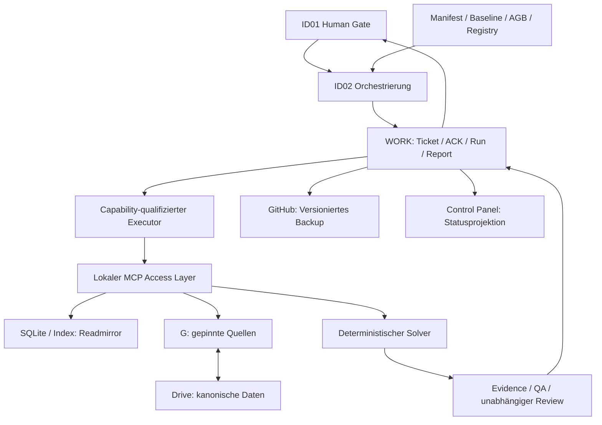

# NEXUS AI-IC Engineering Knowledge Operation System
## Kompaktes Benutzerhandbuch und Implementierungskonzept | v0.1

**Ziel:** Ein nachvollziehbarer, schlanker Arbeitsprozess für Human–LLM–Tool–LLM-Kollaboration, der aus einem Auftrag einen verifizierbaren Engineering-Output erzeugt. Keine neue Plattform neben NEXUS. Die vorhandene Governance, Register, Skills und Schnittstellen werden wiederverwendet.

**Status:** PROPOSED, keine neue Governance, keine Produktionsfreigabe. Quellenabrufe und Dokumenterstellung sind tatsächlich erfolgt; lokale Windows-/MCP-/Solver-Tests und unabhängige Reviews wurden in dieser Sitzung nicht durchgeführt. Die genaue aktuelle Rollenbindung dieser Runtime sowie eine Ledgernummer sind nicht nachgewiesen; daher keine erfundene ID im Dateinamen. Dieses Dokument ist eine konzeptionelle Synthese, kein Installations- oder Testnachweis. Die Techniken des vorliegenden Sprachdialogs sind abgedeckt; kein Anspruch auf Vollständigkeit eines nicht vorliegenden früheren Chattranskripts.

## 1. Drei Leitentscheidungen

| Entscheidung | Umsetzung | Status / Beleg |
|---|---|---|
| Governance zuerst | ID01 → Manifest → Baseline → operative AGB → nachgeordnete Steuerdateien; tatsächliche Version und Rechte je Run prüfen | CURRENT gemäß [S1–S3] |
| Local-first, Registry-first | Drive als kanonischer Datenbestand im vorliegenden Scope; G: als Arbeitskopie, SQLite als rekonstruierbarer Index, GitHub als versionierter Code-/Backupbestand; MCP als kontrollierte Tool-Schnittstelle | Quellenprinzip CURRENT [S2]; konkrete Zuordnung gemäß Workorder, technische Wirksamkeit NOT_RUN [S5–S7] |
| Vertical slice statt Big Bang | Grill-with-docs → Entscheidung/Gate → Spec → Tickets → TDD → Review → Human Gate → Handoff | PROPOSED NEXUS-Adaption von [P1–P9]; bestehende Golden-Slice-Pflicht [S2] |

## 2. Kanonische Orientierung und Arbeitsablage

| Funktion | Quelle / Ziel |
|---|---|
| Manifest und verbindliches Rollenregister | [S1], Manifest §4, NEXUS-ROLES-v1.1 |
| Baseline / MUST-Regeln | [S2], kanonische Markdown-Fassung |
| Hauptsteuerdatei | [S3], `_AGBS.md` im zentralen WORK, gelesene Fassung v007.1 mit Nachtrag 23.11.2026 |
| Frontmatter-Steuerdatei | [S4], v007-ID01-CONTROL-PANEL-START-GATE, ENTWURF; ältere AGB-v003-Referenz dort nicht als Vorrang interpretieren |
| WORK | [S8], `_developement/LLM-LOCAL-SSOT/WORK` (Drive-ID `1HEcfQaf0JlsMPKXlDOz-z6yrVL72ifgP`) |
| Ticket Registry / Workorder Template | [S9], [S10]; kein zweiter Ticket-Master |
| File Registry / Shared Language | [S11], [S12]; keine neuen konkurrierenden Register/Glossare |
| MCP Access Tools | [S5], lokales Arbeitsverzeichnis `G:\Meine Ablage\_developement\MCP-ACCESS-TOOLS`; vorhandenes Servergerüst [S6] |
| Betriebslogs / Troubleshooting | [S13], [S14]; WORK für Aufträge, ACKs, Reports; HISTORY für Watcher/Heartbeat |
| Code / Backup | [S15], privates Repository `julianzotter/nexus-platform`; keine konkurrierende Daten-SSOT |
| Control Panel | [S16], Anzeige/Navigation; kein eigenständiger Wahrheitsbeweis |

Quellenkonflikte sind Findings, keine stillschweigenden Änderungen. Die AGB-§9 bezeichnet die alte Capability-Matrix als historischen Snapshot; keine pauschale Übernahme alter Rechte. Der AGB-Header nennt REGISTRATION_PENDING, der Text v007.1 ist über die kanonische Drive-ID lesbar. Rohbyte-/Ledger-Nachweis der AGB-Aktivierung bleibt getrennt offen. Das frühere Handbuch [S17] ist ein Wiederverwendungskandidat, keine aktuelle Fortschrittsmessung.

## 3. Shared Understanding / Ubiquitous Language

Begriffe des vorhandenen Glossars [S12] verwenden. Folgende Präzisierungen sind Kandidaten für dessen Review, keine zweite kanonische Terminologie:

| Begriff | Eindeutige Bedeutung / Abgrenzung |
|---|---|
| Workorder / Ticket | Versionierter Auftrag mit Ziel, Owner, Eingaben, Abhängigkeiten und messbaren Akzeptanzkriterien; kein Run. |
| Run | Tatsächlicher Ausführungsvorgang mit eindeutiger Run-ID, Runtime, Quellen, Ausgaben und Status; eine Planungsphase ist kein unabhängiger Agenten-Run. |
| Role / Executor / Capability | Verantwortung / konkrete Ausführungsinstanz / nachgewiesene Fähigkeit mit Scope und Laufzeit; eine Rollen-ID gewährt keine Rechte. |
| SSOT / Mirror / Backup | Autoritative Quelle im definierten Scope / rekonstruierbare Projektion / Wiederherstellungskopie; keine Gleichrangigkeit. |
| Publication / Delivery / ACK | Ablage / nachweisbare Zustellung / echte Annahmeantwort des Empfängers. Nicht synonym. |
| Evidence / Review / Release | Prüffähiger Nachweis / unabhängige Bewertung / explizite Freigabe. PASS ist keine Freigabe. |
| Knowledge Object / Locator | Registriertes Wissensobjekt / exakte Fundstelle seiner Quelle. Semantische Ähnlichkeit ist kein Nachweis. |
| Golden Slice | Ein schmaler, vollständiger, reproduzierbar prüfbarer End-to-End-Pfad vom Input zum verwendbaren Ergebnis. |
| Module / Interface / Seam / Adapter | Kapselung von Verhalten / vollständiger Nutzungsvertrag / Ort der austauschbaren Schnittstelle / konkrete Umsetzung am Seam. Architekturvokabular nach [P4]. |

Glossaränderung erst nach Quellenabgleich und zuständigem Änderungsprozess. ADRs nur bei relevanter, schwer reversibler Abwägung, nicht für jede Implementierungsdetails [P3].

## 4. Benutzerhandbuch: ein Standardauftrag

1. **ID01 – Ziel**: Fachaufgabe, Priorität, Projektscope, Ergebnisformat und Freigaberahmen angeben. Beispiel: „Prüfe einen EC2-Bemessungsfall anhand der gültigen AT-Normbasis; liefere Eingabevalidierung, Solver-Nachweis und Review. Keine Projektfreigabe.“
2. **Bootstrap**: Agent liest `_AGBS.md`, Manifest, Baseline, auftragsrelevante WORK-Regeln und Frontmatter-Status. Control Panel öffnen, Quellen-ID, Version, UTC-Abrufzeit, tatsächliche Runtime, Modell, Rechte und Workorder dokumentieren. START_ACK in WORK und Startzeile im HISTORY-LOG nach AGB. Fehlender Zugriff → BOOTSTRAP_BLOCKED für betroffenen Schritt; sichere unabhängige Arbeit und Kommunikation fortführen.
3. **ID02 – Auftragsklärung**: bestehende Tickets und Quellen wiederverwenden. Grill-Entscheidungsbaum abarbeiten (Kap. 6). Fakten selbst recherchieren, offene Freigaben kennzeichnen. Minimum Viable Context mit Quellenreferenzen übergeben.
4. **Routing und Zustellung**: Rollenmanifest + Capability-Probe bestimmen geeigneten Executor. Workorder publizieren, tatsächlich zustellen, ACK/CLAIM getrennt protokollieren. Kein automatisches ACK aus einer Drive-Datei. Bei lokalem Watcher echte Auslösung messen; sonst manuelle Übergabe.
5. **Ausführung**: ID06 bzw. beauftragter Executor nutzt nachgewiesene Tools. Norm-/Materialdaten per Registry suchen, Quellen/Einheiten prüfen, deterministischen Solver ausführen; Eingaben und Resultat versionieren. LLM liefert Interpretation, nicht die verbindliche Rechenautorität.
6. **QA**: ID03 oder separat beauftragte unabhängige Instanz prüft Spec und Standards; ID04 erfasst Provenienz, ID07 kann unabhängig falsifizieren. Bei Fehlern gezielten Refinement-Loop ausführen, kein stilles Ersetzen des Altstands.
7. **Abschluss**: Ergebnis in WORK archivieren, Report-Log und Themenstatus fortschreiben, Registerdelta dem autorisierten Schreiber zuführen. ID02 konsolidiert, ID01 entscheidet. DONE nur gemäß MUST-54; technische Freigabe separat.

Kurzprompt für einen beauftragten Agenten (als kopierbarer Auftrag, nicht als Systemregel):

> Lies die kanonischen NEXUS-Steuerquellen, prüfe Ticket und Runtime-Capabilities. Arbeite genau einen vertikalen Slice ab. Nutze Registry-first Retrieval und deterministische Tools. Dokumentiere Quellen, Input-/Output-Identität, tatsächliche Toolausführung, Tests, offene Gates und nächsten Schritt. Keine fiktiven Runs, keine unautorisierten Writes, keine fachliche Freigabe. Gib einen kompakten Handoff zurück.

## 5. Rollen und Runtime-Capabilities

Lesereferenz aus Manifest §4 [S1], keine alternative Rollenmatrix. Für neue Zuweisungen stets Manifest lesen.

| ID | Verantwortung | Geeignete Arbeit / Einschränkung |
|---|---|---|
| ID01 | Mensch, Entscheidung und Freigabe | Scope, kritische Entscheidungen, Secrets/OAuth, fachliche Freigabe |
| ID02 | ChatGPT Private / Chief Orchestrator | Routing, Workorders, Synthese, Konflikte, Rollout; Tools pro Lauf prüfen |
| ID03 | ChatGPT Assistant / Peer Reviewer | Golden Slice, Akzeptanztests, QA; eigener Entwurf braucht anderen Reviewer |
| ID04 | Gemini | Protokoll, Provenienz, Entscheidungslog, Status; Hash nur bei Bytezugriff |
| ID05 | Perplexity | Externe Primärquellen, Gegenbelege, Recherche |
| ID06 | Claude | Coding, Parser, Registry, Solverintegration, Tests; Codex nur ausdrücklich beauftragter Executor, kein erfundener Akteur |
| ID07 | DeepSeek | Unabhängige Architektur-/Engineeringprüfung; laut [S3] nur Chat/manuelle Übergabe, max. 15 Textdateien; lokale Tests NOT_RUN |
| ID08 | Ollama | Optionaler lokaler Executor, konkretes Modell/Version und Toolzugriff prüfen |
| ID09/10 | Inaktive historische IDs | Keine neuen Aufträge; historische Aliase nur quellenqualifiziert |

Capability-Probe je Run: `provider`, `model_id/version`, `executor_instance`, `role_id`, erlaubte Toolnamen, Read-/Write-Scope, tatsächlicher Zugriff, Netzwerk-/Filesystem-Scope, Testfähigkeit, Beleg und UTC-Zeit. Für nicht nachgewiesene Eigenschaften `UNKNOWN/NOT_RUN` statt „false“ oder „PASS“. Cloud-Clients greifen nicht allein durch Konfiguration auf das Loopback-Interface eines entfernten Windows-Rechners zu. Lokaler Host-Client oder explizit genehmigter, separat geprüfter Integrationsweg erforderlich; kein Tunnel im aktuellen lokalen MCP-Workorder.

## 6. Grill-Me: Entscheidungsbaum und Best-Fit-Entscheidungen

Pococks aktueller Hauptpfad beginnt im Repository mit `grill-with-docs` (ruft `grilling` und `domain-modeling`), nicht mit einer isolierten Prompt-Liste. `grilling` arbeitet in Runden: nur entscheidbare Fragen, Fakten selbst ermitteln, Empfehlung je Frage, nächste Runde erst nach Antworten, bis kein offener Entscheidungsknoten mehr besteht [P1–P3]. Für die vom Nutzer gewünschte autonome Vorarbeit werden reversible Empfehlungen ohne Umsetzung formuliert; echte Human-Gates werden nicht simuliert. Dieses Dokument ist der Vorschlag vor der bestätigten gemeinsamen Verständigung, kein abgeschlossenes Grill-Interview.

| Knoten | Frage / Alternativen | Best-Fit / Begründung | Status / Abhängigkeit |
|---|---|---|---|
| D1 | Neue Governance vs. Bestand? | Bestehende Autorität übernehmen; keine zweite Steuerhierarchie. | SETTLED [S1–S3] |
| D2 | Mehrere Glossare/Registries? | Bestehendes Glossar, Ticket Registry und File Registry nutzen; nur Deltas. | SETTLED [S2–S3] |
| D3 | Direktzugriff aller LLMs vs. lokale Tool-Grenze? | Lokal `127.0.0.1` plus Capability-Probe; Cloud-/Chat-Fallback über geprüften Handoff. | SETTLED Ziel [S7], Runtime NOT_RUN |
| D4 | Drive/SQLite/GitHub als konkurrierende Master? | Drive-Datenautorität, SQLite-Readmirror, GitHub-Versionierung; Konflikte quarantänisieren. | PROPOSED konkrete Konfliktregel, D1/D3 |
| D5 | Freies Schreiben vs. kontrolliertes WORK? | Read default; autorisierte neue WORK-Datei/Append; keine Löschung; technische Security-Denials hart, Lint-Warnungen protokollieren. | SETTLED Rahmen [S3/S7], Implementierung offen |
| D6 | Automatischer Dispatch vs. Mensch/Watcher? | Erst echte manuelle Zustellung; danach lokaler Watcher mit Idempotenz und ACK; GitHub optional. | SETTLED Ziel [S3], Betrieb NOT_RUN |
| D7 | Voller Kontext vs. begrenztes MVC? | Pro Ticket frischer Kontext, gezielter Quellenabruf, reservierter Ausgabe-/Toolpuffer; Handoff statt Vollchatkopie. | PROPOSED, D2/D6 |
| D8 | Agentenrechnen vs. Solver? | Deterministische Fachsoftware; LLM als Orchestrator. Normbasis und Einheiten pro Fall. | SETTLED [S2] |
| D9 | Umfang des ersten Piloten? | Vorhandenen Golden Slice WO-GPT-03 priorisieren, MCP-Zugriff als schmale Vorstufe; EC2-Referenzfall nach erfolgreicher Zugangskette. | PROPOSED, D3/D8 |
| D10 | Review und Promotion? | Spec und Standards separat, zusätzlich unabhängiger Rechencheck; ID01-Gate. | SETTLED [S1/S2], Test-Seams/Reviewer offen |
| D11 | Ledger-/Sync-Konflikt? | Nur autorisierter Einzelschreiber, Deltas, Re-read und Deduplikation; nie nächste Nummer raten. | SETTLED [S3]; Zuordnung alter ID04/Claude-Berichte prüfen |
| D12 | Verhalten bei Drift, Fehler, Kontextverlust? | Betroffenen Schritt blockieren, dokumentieren, sichere Arbeit fortsetzen; erneut bootstrappen. | SETTLED Rahmen [S3] |

Offene Frontier für ID01, jeweils mit empfohlener Antwort: (1) Pilot auf bestehendes WO-GPT-03 plus MCP-Read-Slice begrenzen? Ja, zuerst Nachweise des aktuellen Bestands. (2) Test-Seams MCP-Client, Workorder-State, Solver-Ein-/Ausgabe und Publikations-Readback bestätigen? Ja, keine intern gekoppelten Tests als einzige Abnahme. (3) Konfliktregel D4, Kontextbudget D7 sowie zuständige unabhängige Reviewer bestätigen? Ja, jedoch konkrete Runtime erst nach Probe. Downstream-Fragen (konkrete Schema-/Adapteränderungen und technische Ausrollung) folgen erst nach Ist-Check und diesen Entscheidungen. Keine neue Governance/adopted ADR oder Implementation aus der Synthese allein.

## 7. Pocock-Skills als NEXUS-Workflow

| Skill (Original) | NEXUS-Integration | Nachweis / Exit |
|---|---|---|
| `grill-me` / `grilling` / `grill-with-docs` | ID02 prüft Entscheidungsbaum; offene menschliche Entscheidungen in WORK dokumentieren. | Frontier leer + explizites gemeinsames Verständnis |
| `domain-modeling` | ID02/ID04 schärfen Shared Language im bestehenden Glossar; schwierige Entscheidungen als ADR-Vorschlag. | Quellenkonflikte geklärt, Begriffe eindeutig |
| `codebase-design` | ID06 entwirft kleine, tiefe Interfaces für Retrieval, Workorder-Lifecycle und Evidence; Adapter nur wo Verhalten tatsächlich variiert. | Öffentlicher Vertrag inkl. Fehlern und Invarianten |
| `to-spec` | Synthese als NEXUS-Workorder/Spec, kein erneutes Interview. | überprüfbare Akzeptanzkriterien und vereinbarte Seams |
| `to-tickets` | Vollständige vertikale Slices mit echten blockierenden Kanten; bestehendes Register, keine neue ID-Vergabe. | einzeln demonstrierbare Tickets, Scope pro frischem Kontext |
| `tdd` / `implement` | ID06: ein fehlgeschlagener Verhaltenstest → minimaler Fix → grüner Test → Refactor; Typchecks und volle Suite am Ende. | tatsächliche Testlogs; keine automatische Commit-Freigabe durch Skill |
| `code-review` | getrennte Reviewachsen Standards und Spec; separate Runtime/Reviewer, Engineering zusätzlich unabhängig nachrechnen. | konkrete Findings und Belege, Fix/Retest; kein self-review als unabhängiger Nachweis |
| `handoff` | knappe Übergabedatei mit Links statt Duplikaten; WORK als bewusst angepasster NEXUS-Ablageort. | tatsächliche Übergabe und ACK getrennt |

Upstream-Quellen [P1–P10]. Methoden werden hier adaptiert, nicht als installierte/ausgeführte Pocock-Plugins behauptet. Kein ungefragtes Anlegen von GitHub-Issues oder automatischer Merge; NEXUS-Governance hat Vorrang vor Skill-Defaults.

## 8. Implementierungsarchitektur (Zielbild)

**Module und Seams (PROPOSED; Reuse vor Neubau):**

| Module | Öffentlicher Vertrag / Seam | Invarianten |
|---|---|---|
| Governance Bootstrap | `load_governance` intern; vorhandene Source-Reads | kanonische IDs, Version/Status/Scope; Konflikte melden |
| Retrieval | MCP `search_index`, `read_file`/vorhandenes `fetch_source`, `list_folder` | exakte Suche vor RAG; Allowlist; Quelle, Repräsentation, SHA-256, mtime; Platzhalter ≠ leere Datei |
| Workorder Lifecycle | `get_status`, `get_ledger_row`, autorisierte `create_file`/`append_file` | Ticket/Run-ID, Zustände, Idempotenz, erlaubte WORK-Pfade, keine Löschung/Überschreibung |
| Deterministic Engineering | vorhandene `run_python_tool`/Solver-Adapter, `validate_result` | typisierte Inputs, SI, Norm/NA/Edition, begrenzte Laufzeit, feste Tool-Allowlist; kein beliebiger Code aus Retrieval |
| Evidence / Sync | bestehende Registry-/Backup-Mechanik | Rohbyte-SHA-256, ID und Elternordner, UTC/mtime, versionierte Kopie; Backup kein Release |

Toolnamen aus [S5/S7] sind Zielkandidaten; tatsächlich registrierte Namen per `tools/list` ermitteln. Nicht beide Namensvarianten ohne Bedarf implementieren. FastAPI-Hülle nur, wenn das bestehende Python-Servergerüst die geforderte Schnittstelle nicht bereits ausreichend bereitstellt. Vor Änderungen Serverquellen und Tests lesen, Protokollversion und Host verifizieren. Security-Prüfungen: canonical path auflösen, Traversal/Symlink-Ausbruch abweisen, Token nur aus sicherem Speicher, keine Secrets indexieren, Lese-/Schreibberechtigungen getrennt, Schreibvorgänge idempotent und auf WORK begrenzt. Keine Remote-Freigabe des localhost-Endpunkts. Bei konkurrierenden Writes Konflikt melden statt Datenverlust.

## 9. Datacontracts und Statusführung

Workorder-Pflichtfelder aus MUST-41 [S2]: `ticket_id`, `created_at`, `owner_id`, `priority`, `status`, `source/ssot_anchor`, `objective`, `inputs`, `constraints`, `task`, `expected_output`, `acceptance_criteria`, `dependencies`, `risks`, `next_action`. CLAIM-Syntax `CLAIM <ticket_id> <agent_id>`. Der Parser muss tatsächliche Registry-IDs prüfen; kein erfundener Ticket-Identifier. Beispielstatusfolge: OPEN → CLAIMED → RUNNING → REVIEW_REQUIRED → DONE, alternativ BLOCKED/FAILED. REVIEW_REQUIRED darf in RUNNING zur Nacharbeit zurück; konkreter Zustandsautomat als Vorschlag zu testen, nicht stillschweigend zur Baseline erheben.

Separat halten:

| Dimension | Zulässige Beispielwerte / Regel |
|---|---|
| Ticket | OPEN, CLAIMED, RUNNING, DONE, BLOCKED, REVIEW_REQUIRED, FAILED |
| Development | REFERENCE, INTENT_TO_IMPLEMENT, EVALUATE, PROPOSED, IMPLEMENTED, TESTED, ADOPTED |
| Evidence | VERIFIED / UNVERIFIED / OUT_MISSING; source-to-claim Nachweis |
| Execution / QA | NOT_RUN, PASS, FAIL, REVIEW_PENDING; Testlauf/Beleg erforderlich |
| Persistence | WRITTEN_UNVERIFIED; FILE_VERIFIED / REGISTRATION_PENDING; vollständig nur mit Registerbeleg |
| Delivery | PUBLISHED, DELIVERED, ACKNOWLEDGED; getrennte Ereignisse |
| Release | HUMAN_GATE_PENDING / explizite ID01-Entscheidung mit Scope |

Run-Protokoll MUST-51: `run_id`, `ticket_id`, `agent_id`, `started_at`, `completed_at`, `status`, Quellen/Eingaben, Artefakte, QA-Status, nächste Aktion. Zusätzlich tatsächlicher Executor, Provider, Modell, Runtime, Capability-Evidence, input/output hash und Hash-Scope. Resultatvertrag MUST-45: FINDINGS | EVIDENCE/SOURCES | ARTIFACTS | RISKS | NEXT_ACTION | QA_STATUS. Alle unbekannten IDs als `null` kennzeichnen, bei kritischen Pflichtfeldern Gate melden. Zeit im Dateinamen Europe/Vienna, Ereignisse mit ISO-8601-Offset; Artefaktnummer aus bestehendem Ledger. Ohne belegte Nummer UNREGISTERED/REGISTRATION_PENDING melden. SHA-256 der finalen Rohbytes separat im Receipt dokumentieren, nicht selbstreferenziell in dieselben Bytes einfügen. Bodyhash und Vollfilehash nie gleichsetzen.

## 10. Ausführungsplan: schmale, vollständige Slices

Arbeitsbezeichnungen unten sind **keine registrierten Ticket-IDs**. Vor Anlage vorhandene Tickets [S9] und Workorders [S7] abgleichen, Owner und echte Abhängigkeiten übernehmen. Keine parallelen Master.

| Slice / Verantwortungsrolle | Blockiert durch | End-to-End-Akzeptanz (binär) |
|---|---|---|
| A – Bootstrap und Readback (ID02/ID06) | Zugriff auf Governance | Agent liest AGB/Manifest/Baseline, zeigt Quellen-ID/Version und capability receipt; fehlende Quelle erzeugt BLOCKED, kein falsches PASS |
| B – lokaler MCP Read (ID06) | A; bestehendes Offline-/SQLite-WO | reale lokal gepinnte Testdatei per Client abrufen; bytes/hash stimmen; Platzhalter, Pfad-Traversal und unautorisierter Zugriff werden abgewiesen/gemeldet; zweiter Client |
| C – Workorder Lifecycle (ID02/ID06) | A, B für lokale Adapter | autorisierter Testauftrag → echte Zustellung → ACK → Run → Report; Duplicate/Retry ergibt keine doppelte Ausführung; kein ACK ohne Antwort |
| D – Engineering Golden Slice (ID06/ID03/ID07) | B, C; normative Quellen und geprüfte Inputs | Quelle/Locator → typisierte SI-Eingabe → Solver → unabhängiger Referenzwert → validiertes Ergebnis → Report. Kein Release bei fehlendem NA/Normstand |
| E – Persistenz / Backup / Panel (ID02/ID04/ID06) | C; D für fachlichen Abschluss | autorisierter Testoutput → Drive-Rohbyte-Readback → GitHub-Backup → Registerdelta → Statusprojektion. Konflikt und fehlender ACK bleiben sichtbar; Wiederherstellbarkeit prüfen |
| F – unabhängiger Review / Pilotfreigabe (ID03/ID07, ID01) | A–E | Spec+Standards-Review, kritische Findings geschlossen, unabhängige Evidenz, ID01-Entscheidung. Keine automatische Freigabe |

Pilot: zunächst bestehendes WO-GPT-03 / Semantic MVP / WO12 / WO10-INDEX-FIRST abgleichen. Der alte MCP-README nennt EC2-Concrete-Design, der historische Server nennt HBV-Demo; nicht ungeprüft beide als gleichzeitig freigegebenen Golden Slice behandeln. Projektspezifische HBV-Pipeline bleibt gesondert und erst nach ihren fachlichen Gates. Technische Tests mit synthetischer Fixture dürfen keinen projektspezifischen Nachweis suggerieren.

## 11. Test- und Refinement-Protokoll

An öffentlichen Seams testen; erwartete Ergebnisse aus unabhängiger Spezifikation/Referenz ableiten. Test-first pro Slice, Regression nach Fix, danach vollständige Suite. Beispiel-Abnahme:

| Test | Erwartung |
|---|---|
| G0 Governance/Capability | korrekte Quellen/Versionsidentität; missing source führt zu BLOCKED; keine Rechte aus Rolle abgeleitet |
| G1 Retrieval | exakte Identität/Locator und SHA-256; stale mirror/Platzhalter erkannt; unauthorized path denied |
| G2 Workorder | echte CLAIM/ACK-Ereignisse, eindeutige IDs; paralleler Claim/Retry ohne Doppelrun, Konflikt sichtbar |
| G3 Solver | gültige Fixture stimmt mit unabhängiger Referenz im vorab definierten Toleranzband; Einheitenfehler, bool statt Zahl, NaN/Inf und fehlende Normbasis werden abgefangen |
| G4 Persistenz | gleiche Rohbytes über Quelle/Backup, stabile Provider-ID und bestätigter Zielordner; Registerdelta ohne Kollision |
| G5 Review/Release | separate Reviewerinstanz, vollständige Findings und Retests; ohne Human Gate kein Produktionsrelease |

Drei **echte** E2E-Nachweise als empfohlener Pilotumfang: (1) normaler Golden Slice, (2) Wiederholungs-/Idempotenzfall, (3) kontrollierter Negativfall mit nachgewiesenem Fail-closed. Jeder Lauf eigene Run-ID und Logs; negative Tests sind erfolgreich, wenn erwartetes Blockieren tatsächlich beobachtet wird. Drei Läufe nicht als drei unabhängige Reviews ausgeben. CI- und Coverage-Grenzen aus bestehendem Repo/Workorder ermitteln; keine frei erfundenen Prozentsätze. Status dieses Guides: alle genannten technischen Tests NOT_RUN. Historische Testberichte [S6] sind keine aktuelle Regressionsevidenz.

Refinement: OBSERVE → EVALUATE → PLAN → EXECUTE → VERIFY; bei Risiko FALSIFY. Findings nach Schwere und betroffener Akzeptanzbedingung sortieren, kleinsten Fix umsetzen, gezielt retesten, erneut unabhängig prüfen. Stop bei bestandenem Scope oder dokumentiertem BLOCKED; keine endlose unbelegte Schleife.

## 12. Context- und Run-Management

Ein frischer Kontext ist pro fachlichem Slice und je unabhängiger Reviewinstanz das Ziel, nicht ein maximal gefüllter Kontext. Verfügbares Kontextfenster und Tokenizer sind runtimeabhängig. Vor jedem Run messen (wenn verfügbar):

`input_budget = context_limit - reserved_output - reserved_tool_results - safety_margin`.

Keine universelle Tokenzahl und keine Garantie, dass ein unbekanntes Providerlimit nie erreicht wird. Bei fehlender Messbarkeit kleine Quellenpakete abrufen, lange Quellen seiten-/abschnittsweise lesen, keine unbeschränkten Toolantworten; Budgetüberschreitung vor weiterer Arbeit erkennen. Nur relevante Primärquellen plus Locator, Governance-Version, Workorder, Akzeptanzkriterien, Artefaktlinks, bekannte Findings und offene Gates in den MVC. Keine Secrets oder vollständigen irrelevanten Chats. Bei drohendem Kontextverlust Handoff persistieren, neuen Run tatsächlich starten, Governance neu lesen, an letzter bestätigter Stelle fortsetzen. Keine simulierten Subagenten oder Kontextresets.

| Run-Paket | Zweck | Handoff / Exit |
|---|---|---|
| R1 Quellen/Governance | Identität, Status, Konflikte, Registry | Quellenmanifest mit offenen Gaps |
| R2 Design | Grill-Frontier, Shared Language, ADR-Kandidaten | bestätigte Entscheidungen oder Pending-Frontier |
| R3 Spec/Tickets | Scope, Seams, Abhängigkeiten | eindeutige Akzeptanzkriterien und Ticketlinks |
| R4 Implementierung | ein vertikaler Slice pro Run | Code-Diff, tatsächliche Testbelege, Restaufgaben |
| R5 unabhängige QA | getrennte Spec-/Standards-/Fachprüfung | Review-Receipts, Findings, Retest |
| R6 Integration/Backup | Readback, Register, Status, Human Gate | finaler Status und Wiederanlaufpunkt |

R1–R6 sind vorgeschlagene Pakete, keine Behauptung, dass sechs unabhängige Runs in diesem Chat stattgefunden haben. Für tatsächliche Automatisierung vorhandenen Watcher/Dispatcher und Runtime prüfen; Drive allein startet kein Modell. Ein Handoff enthält Quellenanker, Versions-/Commit-IDs, bestätigte Ergebnisse, offene Fragen, nächste einzelne Aktion und passende Skills. Ein Run kann fortgesetzt werden, ohne dass ein neuer Run fingiert wird.

## 13. Betriebsablauf und Fehlerbehandlung

| Situation | Vorgehen |
|---|---|
| Fehlender AGB-/Registry-Zugriff | BOOTSTRAP_BLOCKED für betroffenen Schritt, [S14] lesen, fehlenden Zugriff melden, unabhängige sichere Arbeit fortführen |
| OAuth invalid_grant | ID01 erneuert erforderliche Autorisierung über Provider/Secret-Store; Poll separat testen, keine Tokens im Report |
| LOCAL/SERVER Drift | Seite, Pfad, Provider-ID, Zeit/Hash vergleichen; alte Kopie markieren, keine automatische Überschreibung |
| Fehlende ACKs | echte Zustellung/Watcher prüfen; kein angeblicher Agentenstart |
| Frontmatter ungültig | YAML-Lint, Fehlerzeile melden, reparierte Version getrennt sichern; kritische Identität/Pfadverletzungen blockieren |
| Unklare Rolle oder Ledger-Schreiber | Manifest und datierte ID01-Entscheidung prüfen; keine Neuzuordnung aus altem Bericht, Delta statt eigenmächtiger Registeränderung |
| Fehlender Rohbyte-Readback | WRITTEN_UNVERIFIED ausweisen; erst mit Bytegleichheit FILE_VERIFIED, danach Registry-Status separat |

## 14. Status, offene Nachweise, nächste Aktion

- VERIFIED (Inhaltsabruf): Manifest NEXUS-ROLES-v1.1, kanonische Baseline-MD, AGB v007.1 plus Nachtrag, Frontmatter-Entwurfsstatus, bestehendes Ticketregister/Glossar, MCP-Workorders und historischer Skeleton-Bericht, Pocock-Originalskills. Keine Rohbyte-Autoritätsprüfung sämtlicher Quellen.
- PROPOSED: D4/D7/D9 und Test-Seams, konkrete Modul-/Adapterauswahl, E2E-Pilotumfang, Ticket-Slice-Zerlegung. Keine stillschweigende Adoption.
- OPEN / NOT_RUN: Ist-Inventar auf G:, Offline-Pins, aktueller SQLite-/MCP-/Watcher-Zustand, echter zweiter Client, deterministische Fachfixture, CI/Coverage, unabhängige Review-Runs, Registry-Eintrag dieses Guides und technische Freigabe. Control-Panel-Start/ACK als Betriebsschritt nicht aus diesem Dokument ableiten. Speicherung/Backup dieses Dokuments werden in einem separaten tatsächlichen Receipt bestätigt.

**Nächster Schritt:** ID02 koordiniert A/B als kleinsten lesenden Golden Slice unter Wiederverwendung von [S7] und [S9]. ID01 entscheidet die drei Frontier-Punkte aus Kap. 6 vor risikorelevanter Implementierung. ID06 liefert tatsächlichen Ist-Check und Tests, danach unabhängiger Review. Kein produktiver Write/Deploy durch dieses Konzept.

## 15. Quellen und Fundstellen

Abrufdatum 24.11.2026. Projektquellen sind privat; Upstream-Skills sind öffentliche Originale (main, zum Abrufzeitpunkt, Commit nicht gepinnt). Vor späterer Implementierung Version/Commit pinnen. Quellenstatus und konkrete Regelstelle im Text beachten.

- [S1] [Manifest MD](https://drive.google.com/file/d/1POfiQCWHDU_7iVMj_A2X3mxNvEjR5Lvn/view), 2026-09-28, §2–6, 9–12; NEXUS-ROLES-v1.1 (11.11.2026).
- [S2] [Baseline MD](https://drive.google.com/file/d/1CdwNHr6i8lMG3k8A939kiznLMw8q7J69/view), MUST-01–06, 10–26, 30–34, 40–55, 60–84, 90–105, 110–123, 130–153 ff.
- [S3] [AGB](https://drive.google.com/file/d/10TzHQJzmqhCjfi1CLYIQyW4J2kyryFqg/view), v007.1, §§0–12, Nachtrag 23.11.2026.
- [S4] [Frontmatter](https://drive.google.com/file/d/1rKnQMZbhO6ii0ThnJLhUCRYrXFcDvRbi/view), v007-ID01-CONTROL-PANEL-START-GATE, Header ENTWURF, Startpflicht/Capability-Snapshot.
- [S5] [MCP-ACCESS-TOOLS README](https://drive.google.com/file/d/1IfDxO5Cnqd6U-17dFaWzNjuWhalUhxBxgnodS0MeDxc/view), MVP, nächster Golden Slice.
- [S6] [MCP Server Skeleton v0.1](https://drive.google.com/file/d/1j1mTGpHsc4N8duA9lBfpLw7rdBCzsWRd/view), historische Layer, Start/Test, Grenzen.
- [S7] [FastAPI MCP lokal v0.2](https://drive.google.com/file/d/19gCrqmughRUZLxLr3oiRYumIpIr0Q_Ec/view), 17.11.2026, Festlegungen/Abnahme; [Offline/SQLite/GitHub-WO](https://drive.google.com/file/d/1Ilq9WNlCa4eqCaiG88q1qSTa_71725RO/view), Teile A–D.
- [S8] [Zentraler WORK](https://drive.google.com/drive/folders/1HEcfQaf0JlsMPKXlDOz-z6yrVL72ifgP), Ordneridentität.
- [S9] [Ticket Registry](https://docs.google.com/spreadsheets/d/1o1ZCZUgsCGTDOwdbJ7EbUCKOKJng1LcJLFnrRiPjYTE/edit), abgerufene Zeilen WO-DS-01, WO-GEM-01, WO-GPT-03, WO-20260927-HBV-PIPELINE.
- [S10] [Workorder Template](https://drive.google.com/file/d/12ZOmBaBPr7L7pFBkZ6g5vilCTZ9OH2P6oqVhjhFVKh0/view), lokalisiert; Pflichtfelder aus S2, Templateinhalt hier nicht separat verifiziert.
- [S11] [File Registry](https://drive.google.com/file/d/15m8T5cWbogIup9snzFwiB1g9HqNCoGow/view), AGB §6 referenziert; keine neue Registrierung vorgenommen.
- [S12] [Shared Language / Glossary](https://drive.google.com/file/d/1MnHMlbPgKRNUlSiW7SzRk20EvLrSLEOJ/view), 2026-11-02-supplement-1, Candidate, Core Vocabulary.
- [S13] [HISTORY-LOG](https://drive.google.com/drive/folders/1uavEf5g_ZisiEMsksrGi_KYzMsx37DWc), AGB-Referenz.
- [S14] [Troubleshooting](https://drive.google.com/file/d/1OXKmuSPdXTwwy3AfECQR4hRm1iNu_4JR/view), v001, T01–T08.
- [S15] [nexus-platform](https://github.com/julianzotter/nexus-platform), private Repo-Metadaten und README gelesen; Default `main`, Schreibrecht gemeldet. Kein Produktivmerge beauftragt.
- [S16] [Control Panel](https://nexus-sync-diagnose.julianzotter.chatgpt.site), AGB-Nachtrag; Funktionsstatus nicht verifiziert.
- [S17] [Whitepaper + Manual v1.0](https://drive.google.com/file/d/1N-HUl4Bq8DffMMF1FqLxPmjpTRV-lahl/view), 28.09.2026, PROPOSED; Einleitung/Scope, keine Übernahme alter Prozentwerte.
- [P1] Matt Pocock, [grill-with-docs](https://github.com/mattpocock/skills/blob/main/skills/engineering/grill-with-docs/SKILL.md), Skill-Delegation; [grill-me](https://github.com/mattpocock/skills/blob/main/skills/productivity/grill-me/SKILL.md).
- [P2] [grilling](https://github.com/mattpocock/skills/blob/main/skills/productivity/grilling/SKILL.md), Entscheidungsbaum, Frontier, Fakten vs. Entscheidungen.
- [P3] [domain-modeling](https://github.com/mattpocock/skills/blob/main/skills/engineering/domain-modeling/SKILL.md), Glossar, Szenarien, ADR-Kriterien.
- [P4] [codebase-design](https://github.com/mattpocock/skills/blob/main/skills/engineering/codebase-design/SKILL.md), Interface/Seam/Depth.
- [P5] [to-spec](https://github.com/mattpocock/skills/blob/main/skills/engineering/to-spec/SKILL.md), Spec/Seams.
- [P6] [to-tickets](https://github.com/mattpocock/skills/blob/main/skills/engineering/to-tickets/SKILL.md), Vertical Slice, Blocking Edges.
- [P7] [tdd](https://github.com/mattpocock/skills/blob/main/skills/engineering/tdd/SKILL.md), Verhaltenstests, Seams, unabhängige Referenzen.
- [P8] [code-review](https://github.com/mattpocock/skills/blob/main/skills/engineering/code-review/SKILL.md), getrennte Standards-/Spec-Achsen.
- [P9] [handoff](https://github.com/mattpocock/skills/blob/main/skills/productivity/handoff/SKILL.md), kompakte Referenzen, Redaction.
- [P10] [implement](https://github.com/mattpocock/skills/blob/main/skills/engineering/implement/SKILL.md), TDD, Typechecks, Suite, Review; Commit-Regel unter NEXUS-Gate.
