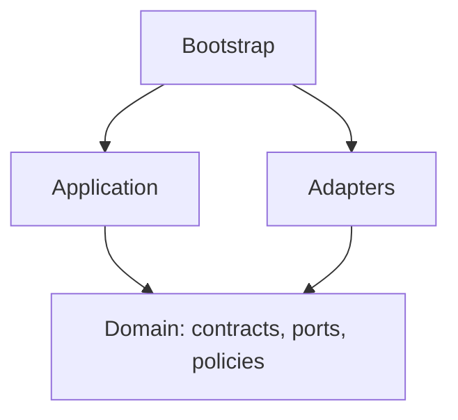

# Architektur und Entscheidungen

## Abhängigkeitsmodell — DERIVED, lokal maschinell geprüft

Pfeile zeigen Quellcode-Abhängigkeiten. Application und Adapters importieren
einander nicht. Bootstrap stellt konkrete Implementierungen zusammen. Ein
Workflow ruft zur Laufzeit den übergebenen `SolverPort` auf; der Datenfluss kann
Ergebnisse zurückgeben und iterieren. Eine Antwort ist keine rückwärts gerichtete
Quellcode-Abhängigkeit.

Die Domain importiert Standardbibliothek und eigene Module; keine
Herstellerbibliotheken oder Drittframeworks. Alle Protocol-Methoden sind durch
statische Typprüfung zu prüfen. `Protocol` allein garantiert weder Laufzeittypen
noch fachliche oder numerische Richtigkeit.

## ADR-001 — Kapselung nach Verantwortung

Die ursprünglichen acht Verantwortungsbereiche bleiben eine Orientierung:
Numerik, Semantik, Geometrie, Austausch, Postprocessing, Fachregeln,
Orchestrierung und Präsentation. Sie sind keine erzwungene lineare Pipeline.
Ein Programm kann mehrere Verantwortungen implementieren. Die behaupteten
mehrjährigen Änderungsintervalle wurden nicht übernommen.

## ADR-002 — Verträge sind herstellerunabhängig

Analytische Modelle enthalten keine RFEM-/CAD-Klassen. Unterschiedliche Solver
sind nur für einen nachgewiesenen gemeinsamen Modell- und Ergebnisumfang
austauschbar. Adapter müssen alle Fähigkeiten selbst testen und Unverträglichkeit
vor einer mutierenden Solveraktion melden. Ein reiner Ergebnisleser benötigt
einen eigenen Read-Port; er darf nicht als `solve`-Implementierung ausgegeben werden.

## ADR-003 — Datentypen und Runtime-Validierung

Domain-Dataclasses sind `frozen=True, slots=True`. Ihre Felder enthalten nur
immutable Tupel, Strings, bool/int, endliche Decimal-Werte, Null oder weitere
ebenso validierte Verträge. Listen, Dictionaries, beliebige Objekte und Floats
werden an normalen Konstruktorgrenzen abgewiesen. Es gibt keine freitextlichen
Mapping-Felder, deren Unveränderlichkeit lediglich behauptet wird.

Die gemeinsame Basisklasse prüft die tatsächlichen Werte gegen die Annotationen;
Literal-Werte werden zur Laufzeit geprüft. Darauf folgen Fach-/Referenzinvarianten.
Python-Reflection/`object.__setattr__` lassen sich damit nicht zu einer
Sicherheitsgrenze machen. Es handelt sich um API-Verträge, nicht um eine Sandbox.

## ADR-004 — Genau ein Typmodell, zwei Prüfebenen

Die Python-Typen sind SSOT. `adapters/schema_export.py` generiert daraus
Draft-2020-12-Strukturschemata. `json_codec.py` decodiert dieselben Typen und
verwirft zusätzliche oder fehlende Felder, doppelte JSON-Schlüssel,
Float-/NaN-Tokens und falsche Varianten. Anschließend laufen alle
Domain-Invarianten.

Bewusst keine zweite manuell gepflegte Pydantic-Modellhierarchie und keine
Abhängigkeit von `dataclasses-jsonschema`. Ein späterer Pydantic-TypeAdapter ist
möglich, muss aber dieselben Gold-/Negativfälle bestehen. Der kleine enthaltene
Schemaexporter unterstützt ausschließlich die hier verwendete Typmenge und ist
kein allgemeiner Ersatz für eine Validierungsbibliothek.

## ADR-005 — Capability-Profile als konservative Alternativen

Je Analysezustand wird das vollständige dargestellte Tragwerk geprüft. Die
Lastarten stammen aus allen mit Nichtnull-Faktoren aktivierten Lastfällen;
Knotenlasten bleiben Teil dieses Zustands. Eigengewicht, Initialzustandsbezug,
Formfindungsziele und gedrehte Lager werden gesondert erfasst. Auch unbelastete
Zustände werden nicht übersprungen.

Ein einzelnes Capability-Profil muss alle Anforderungen gemeinsam abdecken.
Profile mit unterschiedlichen IDs sind Alternativen; sie werden nicht zu einer
angeblich stärkeren Fähigkeit zusammengelegt. Doppelte IDs sind ungültig.
Das Verfahren behauptet keine Lastpfadermittlung. Es kann konservativ ablehnen;
es führt keine mechanische oder topologische Solveranalyse aus.

## ADR-006 — Austausch und Mapping

`ExchangePort` gilt hier ausschließlich für analytische Modelle. Ein IFC-
Bauteilmodell, eine DWG-Zeichnung und ein analytisches Modell sind unterschiedliche
Verträge. Ein späterer Import muss Codec, Transport und fachliches Mapping
trennen und Informationsverluste in `MappingReport` ausweisen. Abwesende
Zielfelder rechtfertigen kein stilles Weglassen relevanter Quellmerkmale.

Der enthaltene JSON-Adapter hat keinen solchen Fachkonvertierungsverlust und
verwirft unbekannte Eingabefelder. Es gibt keinen implementierten IFC-/DXF-/DWG-Import.

## ADR-007 — Ausführung, QA und Freigabe

Fixture-Ausführung, wirklicher Solverlauf, Nachweisbewertung und technische
Freigabe sind getrennte Zustände. Die Software kann eine Datenstruktur und ihre
Rückbindung prüfen. Sie kann aus diesen Prüfungen keine statische Freigabe ableiten.
GitHub-CI ist als Datei vorbereitet; in diesem Paket behauptet kein Status einen
tatsächlich erfolgten Remote-CI-Lauf.
