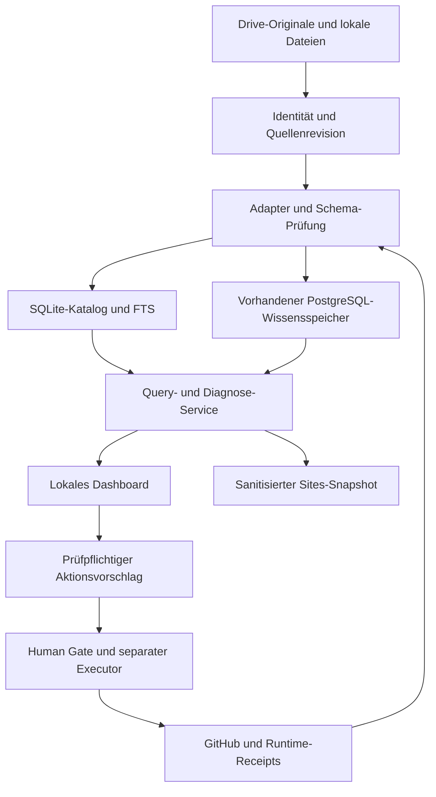

# NEXUS Knowledge System – Implementierungsplan
KI redet – deterministischer Code entscheidet – Git beweist es.

## 1. Entscheidungsvorlage und Auftragsgrenze
Drei Hauptziele:
1. Bestehende Quellen, Indizes und Knowledge Objects zuverlässig auffinden, versionieren und mit belegten Fundstellen wiederverwenden.
2. Ausführung, Monitoring, Diagnose und Evaluation anhand echter Lauf- und Ergebnisnachweise verbinden.
3. Eine gemeinsame Datenprojektion für lokale Dashboards und die private Sites-Oberfläche bereitstellen; Steueraktionen erst nach eigener Autorisierung und technischer Rechteprüfung.

Status des Plans: PROPOSED / REVIEW_PENDING. Beauftragt sind Planung, additive Ablage und GitHub-Review-Snapshot. Nicht beauftragt sind Implementierung des Systems, neue Scheduler, OAuth-Consent, Secret-/ACL-Änderungen, Modellinstallation, API-Kosten, Datenbankmigration, produktive Schreibtests oder Release. Die bestehende Diagnose-Site wird in diesem Auftrag nicht geändert.

Dieser Plan erweitert keine NEXUS-Governance. Er konkretisiert die gelesenen Regeln und benennt Architekturentscheidungen ausdrücklich als Vorschläge. Arbeitsfähige, unabhängige Entwicklung bleibt bei Einzelblockern möglich; fachliche Freigaben und kritische Aktionen bleiben gesperrt. [S01–S04]

## 2. Quellenlage und belastbarer Ausgangsstand
Quellenabruf am 20.11.2026; Zeitpunkt je Abruf im Begleitnachweis. Keine vollständige Inventur aller Laufwerke, Chats, Drive-Ordner oder Repositories. Windows-Dienste sind aus dieser Cloud-Sitzung nicht live geprüft.

| Bereich | Feststellung | Evidenzklasse und Grenze |
|---|---|---|
| Operative Regeln | _AGBS.md am kanonischen Ziel enthält v007.1; Manifest/Baseline als MD sind kanonisch, native Docs Archiv | VERIFIED_CONTENT; _FRONTMATTER bleibt ENTWURF. Historischen Aktivierungssatz in AGB §12 nicht als aktuellen v006-Betriebsstand übernehmen. [S01–S04] |
| Dokumentationsbestand | Plattform-Handbuch 18.11. ist ein gemischtes Transkript; DSH-Guide 19.11. v1.0.0 ist REVIEW_PENDING | VERIFIED_CONTENT, keine Abnahme der dort beschriebenen Infrastruktur. [S06–S08] |
| GitHub | gelesene Läufe gehören zu Commit 61849c90b45b6e7376a197fd1e9508ded154f860 | VERIFIED GitHub-Runs; kein Live-Zugriff auf Windows daraus ableitbar. [S11] |
| Sync | Poll 44691542520 und Delivery 44666539475 failure; aktueller Gates-Bericht: INVALID_GRANT, Delivery übersprungen | Laufstatus direkt VERIFIED; detaillierter OAuth-Befund im Quellenbericht belegt, in diesem Auftrag nicht neu am Runner reproduziert. [S09–S11] |
| CI | Run 44599353545: No module named 'dlubal', 1 failed, 333 passed, 1 skipped, 36 subtests passed | VERIFIED aus Job 135826199769. Historischer Duplicate-ID-Fehler daily-recall/model-effort-router ist ein eigenes Fehlerbild; die CI war am 17.11. grün, ist am aktuellen Commit fehlerhaft. [S11] |
| Registry | gelesene Rohdatei: 470 JSONL-Records parsebar; SHA-256 dfc3dd2ad5d17322a6307f393ebb9e79531053d057ec20cf0e00c2d9d4b1f716 | CALCULATED durch Python über decodierte Provider-Rohbytes; syntaktische Lesbarkeit ist keine semantische Vollständigkeit. [S05] |
| Ticket-/Konzeptregister | #73 BLOCKED im bestehenden Ticketregister; WO-GPT-03 enthält den gemeinsamen Semantic-/Index-Pilot; AIM v0.3.4 ENTWURF | VERIFIED_CONTENT; keine neuen Masterregister oder externen ACKs erfinden. [S12–S13] |
| Lokaler Stack | Bericht nennt PostgreSQL/pgvector, 1 Dokument, 25 Chunks, 6 CAG-Blöcke, SQLite-RO-Replikat und vier MCP-Tools; Transkript enthält auch Verbindungsfehler | REPORTED, nicht von dieser Instanz lokal nachgemessen. Wiederverwenden und Zustand neu belegen, nicht pauschal als fehlend oder produktionsreif darstellen. [S14] |
| Ollama/Qwen | Dateibaum nennt qwen3.5:4b; separates Dokument meldet 404 model not found | REPORTED / widersprüchliche Laufzeitlage. Manifestdatei ≠ aktiver Serverbestand ≠ erfolgreicher Chat ≠ Toolfähigkeit. [S15–S16] |
| AnythingSearch | Inspektionsbericht nennt Files(Id,Name,FolderId,Ext,Size,Modified,IsFolder) und Folders(Id,Path) | VERIFIED_CONTENT als historischer Schemaauszug; kein Content-/FTS-Index aus diesen Tabellen behaupten. [S17] |
| Private Diagnose-Site | Im vorangegangenen Chat erstellter Snapshot vom 17.11. mit getrennten Sync- und CI-Ansichten | CHAT_CONTEXT; keine heutige Browser-/Backend-Abnahme. Seite muss neue Snapshot-Zeit, Herkunft und CI-Delta zeigen, bevor sie als aktuell gilt. |

Zwei Quellenkonflikte explizit erhalten: Der CPLM-Bericht verwendet teilweise alte native Governance-Links und die frühere Folder.md-ID, während AGB und aktuelles Repository auf MD und Folder-ID 1nDjF78dq3l8PGpXsauzBz1bzHescDSwv zeigen. Den Bericht als Befundquelle nutzen, seine Source-Liste nicht ungeprüft als Bootstrap übernehmen. Die Aussage „exklusiver authentifizierter Writer“ und die gemeldete offene WORK-ACL sind ebenfalls getrennte Betriebsbedingungen; aktuelle ACL hier nicht erneut live geprüft. [S01,S09,S10]

## 3. Zielarchitektur und Zuständigkeiten
Vorgeschlagene Grundstruktur: vorhandene Bausteine konsolidieren, Datenverträge zuerst, dann ein ausführbarer vertikaler Slice.

| Schicht | Autorität / Verantwortung | Nicht übernehmen |
|---|---|---|
| Originalquellen | Drive-Provider-ID bzw. lokaler Ursprung, unveränderte Originalbytes, Revision und Rechte | Extraktion als Original ausgeben |
| Governance / Register | bestehendes file-registry.jsonl, Ticketregister, Manifest, Baseline; Ledger nur benannter Writer | SQLite, Folder.md oder neues JSONL als konkurrierendes Masterregister |
| Code / Verträge | Git-Commit, Tests, Review und kontrollierte Releases | Commit als Cloud-Zustellung, ACK oder menschliche Freigabe deuten |
| SQLite-Katalog | vorhandener lokaler Katalog/AnythingSearch als Router; versionierte abgeleitete Metadaten-/FTS-Projektion | aktive DB auf Drive-Mount durch mehrere Prozesse schreiben |
| PostgreSQL/pgvector | bereits berichteten Wissensbestand prüfen; ssot_documents/rag_chunks/cag_blocks erhalten und migrieren nur nach Mapping | zweite unabhängige Quellenidentität oder Doppelpflege |
| Ereignisse / Diagnose | Run-, Step-, Ergebnis-, Delivery-, Readback- und Review-Receipts korrelieren | fehlende Beobachtung als Erfolg behandeln |
| FastMCP / HTTP | enge Query-/Diagnose-API; dieselbe Anwendungslogik für MCP und Dashboard | generischen SQL-, Shell- oder Dateischreibzugriff für das Modell |
| LLM / Harness | Intent, Triage, Extraktionskandidaten, textueller Review | Rechenautorität, Statuspromotion oder automatische Freigabe |
| Fachsoftware | versionierter Solver/RFEM/Excel-Rechenkern mit geprüften Eingaben | „LLM plausibel“ als Fachnachweis |
| UI | belegte Projektion, Filter, Quellensprung, Vorschläge und separate Freigabeansicht | Frontend-Button als Rechte-/Sicherheitsgrenze |

### 3.1 Speicherentscheidungen
- SQLite-Arbeitsdatenbanken außerhalb des synchronisierten Laufwerks, vorhandene Pfade zunächst verifizieren. C:\NEXUS\nexus-index ist ein belegter Entwurfspfad, keine hier neu eingerichtete Instanz.
- Konsistentes SQLite-Backup über die Backup-API; ruhenden Snapshot prüfen und danach als RO-Replikat verteilen. Leser mit URI mode=ro und Betriebssystemrechten; immutable=1 nur für tatsächlich unveränderliche Kopien. [W01,W02]
- Vorhandenen PostgreSQL-Pilot zuerst auf Schema, Besitzer, Rechte, Backup und Rebuild prüfen. Für einen einzelnen lokalen Metadaten-/Status-Slice genügt SQLite; bestehende Vektordaten bleiben erhalten. Skalierung zu PostgreSQL nicht automatisch zum Pflichtblocker des ersten Dashboards machen.
- Ein fachliches Knowledge Object hat genau einen logischen Ursprung und nachvollziehbare Revisionen; Suchindex, Vektoren und Graph sind daraus abgeleitete Projektionen. Konflikte über explizite Versionen, nicht „letzte Datei gewinnt“.
- Git plus Hashkette erhöht Nachvollziehbarkeit, ist allein kein WORM. Echte Unveränderlichkeit nur nach nachgewiesener Retention-/Speicher- und Administratorgrenze behaupten.

## 4. Wiederverwendung statt zweitem Framework
Am Referenzcommit wurden folgende Originaldateien gelesen:

| Vorhandener Baustein | Wiederverwendung | Nötige Erweiterung / Abnahme |
|---|---|---|
| tools/monitor_repo.py | Registry-, Knowledge-, Coverage-, PR- und Scheduler-Prüfung | Local-/MCP-/DSH-Adapter, eindeutige Runs, Quellenalter, Fehlerklassen ergänzen; keine Duplikat-Monitorpipeline |
| tools/assert_operational_evidence.py | tatsächlichen Betrieb vom Actions-Jobstatus trennen | INITIALIZED nicht als operativer Folgepoll anzeigen; fehlende Run-ID und Consumer-ACK explizit |
| tools/export_dashboard.py | commitgebundener, lesender Snapshot mit Reporthash | kompatible Snapshot-v2-Migration; Legacy-Export erhalten |
| schemas/dashboard-snapshot.schema.json | bestehender nexus-integration/1-Vertrag | additionalProperties=false verbietet stilles Anhängen neuer Felder; v2 als eigener, zu prüfender Vertrag |
| schemas/knowledge-item.schema.json | bestehende einfache Knowledge Items und Signoff-Struktur | vorhandene interne 16-Hex-source_file_id nicht mit opaken Drive-IDs überschreiben |
| KnowledgeObject v0.4.0 REVIEW | detaillierter Source-/Norm-/Context-/Governance-Vertrag | Status NOT ADOPTED erhalten; Mapping, Testfixtures und Human-Adoption vor Migration |
| prototypes/data-dashboard | Offline-HTML, Filter, Dateiimport/-export, deterministischer Build | gemeinsame Snapshot-Daten und Statusachsen; Sprachaufnahme im privaten/offline Modus deaktiviert |
| knowledge/nexus-aec-seed | vorhandene Seedliste, Validatoren und META_WISSEN-Vertrag | reale letzte Läufe und Rechte aktualisieren; keine doppelten wöchentlichen Suchjobs |

Quellen: [S18–S23]. Quellcodelektüre ist keine hier ausgeführte Funktionsprüfung. Die beschriebenen Änderungen werden erst in separaten Implementationstickets gebaut.

### 4.1 Datenvertragsmigration
Provider-ID, interne Katalog-ID und Knowledge-Object-ID getrennt speichern:
- provider_object_id: unveränderte Drive-/GitHub-/lokale Objektkennung.
- source_id: persistente interne Quelle mit Provider-/Account-/Scope-Bezug.
- representation_id: Repräsentation einer konkreten Revision, MIME, Rohbytehash und Parserstand.
- object_id: stabiler Knowledge-Begriff/Satz, revision_id: geprüfter Inhaltsstand.
- Alias-Tabelle verbindet bestehende 16-Hex-IDs und gdrive:IDs; keine Kürzung opaker IDs.
- Bestehende Datensätze zunächst verlustfrei lesen; Migration als additiver, reversibler Adapter mit Vorher-/Nachher-Zählungen und Quellhashes. Keine globale Umnummerierung.

## 5. Intelligent Atomic Knowledge Objects
Hier als Konzept definiert: kleinste fachlich sinnvoll eigenständig prüfbare Aussage, Regel, Kennwert, Entscheidung, Formel oder Beobachtung mit festem Anwendungsbereich, Quellenanker und Versionsbindung. „Intelligent“ bezeichnet Verknüpfung und Wiederverwendung; keine autonome Wahrheitserzeugung. Ein Chunk ist ein Textausschnitt, ein Knowledge Object eine kuratierte Aussage; beide nicht gleichsetzen.

| Feldgruppe | Pflichtinhalt im vorgeschlagenen Mapping |
|---|---|
| Identität | object_id, revision_id, object_type, title, language, schema_version |
| Inhalt | genau ein prüfbarer Kern; payload; Definition und Geltungsbereich |
| Provenienz | source_id, Provider-ID, canonical_uri, source_revision, MIME, representation_sha256, locator, retrieved_at |
| Kontext | Projekt, Domain, Bauteil/Material, Annahmen, Einheiten, Anwendbarkeit |
| Fachgrundlage | Normteil, Ausgabe, nationaler Anhang, Generation, Stichtag, Clause/Table/Equation bzw. nichtnormative Quelle |
| Beziehungen | derived_from, supports, contradicts, supersedes, applies_to; jede bestätigte Beziehung mit eigenem Beleg |
| Qualität | Evidenzklasse, Extraktionsstatus, Teststatus, unabhängiger Review, Human Gate, bekannte Widersprüche |
| Runtime | run_id, tatsächliche Instanz, Provider, Modellkennung soweit verfügbar, Parser-/Solverversion |

Pipeline: Original → Identität/Revision → Extraktion → Kandidat → deterministische Struktur-/Fundstellenprüfung → unabhängige fachliche Prüfung → menschlich angenommene Revision → Retrieval-/Graph-Projektion. Ein LLM darf einen Kandidaten vorschlagen, aber VERIFIED nicht allein durch eigene Behauptung setzen. JSON-Schema prüft Struktur, nicht Normgeltung oder fachliche Richtigkeit. [S03,S19,S20]

Für Engineering wird die ID01-Normengrundlage vom 19.11. als eigener Input eingebunden; exakte Ausgaben und NA vor fachlicher Nutzung direkt prüfen. Dieser Architekturplan reproduziert keine Normparameter und führt keine Bemessung durch.

## 6. Ingestion, Datei- und Websuche
### 6.1 Bestehende Indizes integrieren
1. Vorhandene _INDEX.MASTER-, AnythingSearch-, TreeSize-, TREELIST-, DIRLIST- und SearchResult-Exporte zuerst registrieren und auf Alter/Abdeckung prüfen.
2. Jede Importquelle erhält exportiert_am, importiert_am, Host/Laufwerk, Root, Zeitzone, Schema/Encoding, Filter und Abbruch-/Paginationstatus.
3. AnythingSearch zuerst über Files JOIN Folders als Metadaten-Router verwenden. Modified-Wert nicht ungeprüft als Unix-Zeit interpretieren; Datentyp und tatsächliche Zeiteinheit testen. Dateihash/Inhalt separat am Original erheben.
4. Verzeichniseinträge als Standortbelege, nicht als Dateiinhalt oder Offline-Pinning ausgeben. Fehlende Dateien als NOT_FOUND, unzugängliche als ACCESS_DENIED, ausgelassene als NOT_SCANNED erfassen.
5. Deduplizierung: Provideridentität zuerst; gleiche Namen/Größen nur Kandidat. Identische Bytes erlauben Content-Link, nicht Löschen oder Zusammenlegen verschiedener Rechte-/Projektkontexte.
6. „DIE LUST“ aus dem Auftrag bleibt UNRESOLVED_TERM. DIRLIST ist ein separat belegter Importtyp; keine Gleichsetzung ohne Bestätigung. Dieser Begriff blockiert den übrigen Plan nicht.

### 6.2 Dokumente und OpenDocument
Originale erhalten; Text-, JSON-/CSV-, Office-/OpenDocument-, PDF-, Bild- und CAD-Repräsentationen getrennt:
- UTF-8/JSON/JSONL/CSV: Encoding, Trennzeichen, Datentyp und Schema prüfen.
- DOCX/ODT: Absätze/Überschriften, Tabellen und Fußnoten mit Locator; Formatkonvertierung dokumentieren.
- XLSX/ODS: Blatt/Zelle, Formel und gecachter Wert getrennt; Parserimport ist kein nativer Rechenlauf. Externe Links/Makros nicht automatisch ausführen.
- PDF: Seite/Region, Textlage, Tabellenlayout und OCR-Status; Formel-/Tabellenerkennung ist prüfpflichtig. OCR-Output nie still als identische Originalquelle behandeln.
- CAD/BIM/RFEM: Objekt-/Element-ID, Modellrevision, Einheitensystem und Adapter; Geometrie- und Solverergebnis separat.

OpenDocument als offenes Austauschformat unterstützen, ohne Google Docs und Raw Markdown zu verwechseln. Die OASIS-Spezifikation ist eine Formatquelle; keine behauptete neue NEXUS-Standardadoption. [W06]

### 6.3 Priorisierte Open-Access-Websuchlinklisten
Vorhandene AEC-Seedliste weiterführen: OIB, EOTA, TU-Repositum, Dlubal-Dokumentation; Material-/LCA-/Zirkularitätsdaten aus den bereits vorgesehenen Fachquellen; Holzbau-Watch separat erhalten. [S23]
Pro URL: kanonische Adresse, Herausgeber, Fachgebiet, Dokument-ID/Ausgabe, Abrufzeit, HTTP-Ergebnis, Redirect, Inhaltshash, Lizenz-/Zugriffsstatus, nächste Prüfung, letzter Lauf. Öffentlich erreichbar bedeutet nicht frei weiterverbreitbar.
Web-Extraktionen in Staging, nie direkt in verifizierte Norm-/Materialwerte. URL-Status ≠ Inhalt geprüft. Suchtreffer ≠ Primärquelle. Robots-/Zugriffsgrenzen respektieren, kein Umgehen von Schutzmaßnahmen.
Bekannte abgeschaltete oder fehlerhafte Quelle führt zu Hinweis/Quarantäne, nicht zur Löschung historischer Nachweise.

## 7. Retrieval und Knowledge-Evaluation
Suchreihenfolge: exakte ID/Pfad/Registry → Metadatenfilter → FTS/BM25 → vorhandene Hybrid-/Vektorsuche als Ergänzung → Originalfundstelle prüfen. [S03,W03]
- SQL parametrieren; feste Query-Templates mit erlaubten Tabellen/Spalten, maximaler Trefferzahl, Timeout und Seitenbildung.
- Embeddingmodell, Digest/Revision, Dimension, Chunker und Indexrevision speichern. Unterschiedliche Modelle oder Dimensionen nicht im selben Vergleichsraum mischen.
- Bei Formel-, Kennwert- oder Normfragen: Fachprofil/Projekt/NA zuerst filtern, widersprüchliche Editionen sichtbar lassen.
- Antwort zeigt Beleganker und gültigen Geltungsbereich; bei fehlender kritischer Quelle UNVERIFIED/Abstention.
- Semantic Similarity nur Ranking, kein Confidence-Prozent und kein Beweis einer fachlichen Beziehung.

Vorgeschlagener Abnahmesatz: 30 eingefrorene Fragen, davon 10 exakte Fundstellen, 10 fachlich paraphrasierte Retrievalfragen, 10 Negativ-/Konflikt-/Berechtigungsfälle. Menschlich vorbereitete Referenzantworten; Testset getrennt von Promptoptimierung. Kritische Identitäts-/Rechte-/Normen-Negativfälle müssen alle korrekt abgewiesen/markiert werden. Retrieval@5, Fundstellenrichtigkeit und Abstention getrennt messen; Zielwerte für nichtkritisches Ranking nach Baseline-Messung und ID01-Entscheidung festlegen.

## 8. AI-Stack, DeepSeek Harness, Ollama und FastMCP
### 8.1 Laufzeitinventar
Ein datiertes Inventar je tatsächlichem Host: OS, Python/Node, Harness-Version, aktives Profil, Config-Hash ohne Geheimwerte, Plugin-/Skill-Versionen, Modelltag/-Digest, Transport, Tool-Schema, Rechte und letzter realer Test. Rollen-ID ersetzt weder Runtime-Identität noch Fähigkeiten.

Wiederverwenden: lokale DSH-Dateisuche/ripgrep, offizieller MCP-Manager, vorhandene NEXUS-Bridges. Community-Plugins erst nach Versions-, Lizenz-, Dependency- und Rechteprüfung. Versionen nicht aus Beispieldateien übernehmen.

### 8.2 Ollama-/Qwen-Diagnose
Zuerst denselben Host, Port, Dienstprozess und Modell-Speicher identifizieren; danach GET /api/tags und den tatsächlich verfügbaren OpenAI-kompatiblen Katalog vergleichen. Ollama dokumentiert /v1/models; die pauschale Aussage, dieser Endpunkt könne lokale Modelle nicht listen, wird nicht übernommen. [W04,W05]
Bei 404: exakten Modellnamen und Digest, DSH-Provider-ID, Endpoint/Requestpfad und aktives Profil korrelieren. Das Entfernen von /v1 ist keine allgemeine Reparaturregel. Keine automatische Modellinstallation oder Dienstneustarts.
Nach expliziter Testfreigabe: ein synthetischer Inferenztest, ein Schema-/Tool-Call-Test, ein Timeout und ein unzulässiger Toolaufruf. Erst daraus Toolfähigkeit, Latenz und Einsatzbereich ableiten. „Open weight“ gesondert von Lizenz, ausführbarem Code, Telemetrie und Datenabfluss beurteilen.

### 8.3 MCP-Transport und Zugriffsgrenzen
- Bestehende SSE-Instanz :8081 nur als berichteten Bestand aufnehmen; Version und tatsächliche Tools neu prüfen.
- Neue Netzwerkstrecken mit Streamable HTTP evaluieren; SSE ist laut FastMCP Legacy-Kompatibilität, stdio für lokale Clients weiter geeignet. Keine Transportmigration ohne Client-Vertragstest. [W07]
- Cloud-Sites oder Cloud-LLM erreichen Windows-localhost nicht automatisch. Zunächst sanitisierte Snapshot-Übergabe; optional später authentifizierter Gateway/Tunnel mit eigenem Sicherheitsauftrag. Keine öffentliche Freigabe von PostgreSQL/Ollama/FastMCP.
- Read-only nicht nur im Prompt: OS-/DB-Rechte, Tool-Allowlist, Pfad-/Scopeprüfung, parameterisierte Queries und serverseitige Autorisierung.
- Kein beliebiges Shelltool hinter einer Dashboard-Aktion; lokale Arbeitsprozesse als kontrollierte Executor-Jobs.

Wichtige Korrektur des DSH-Guides: Der aktuelle offizielle MCP-Manager dokumentiert, dass ein OAuth-Probe einen Grant erneuern und Tokens speichern kann. Daher zuerst statische Config-/Schema-Inspektion, dann Probe eines synthetischen nicht-OAuth-Servers; authentifizierte Probe separat als potenziell zustandsändernd behandeln. disabled=true bedeutet keine pauschale Nebenwirkungsfreiheit. [W08]

### 8.4 Privacy und Kosten
DSH-Session-Log-Upload und OTel-Kanal getrennt prüfen. Lokales Modell allein beweist Zero Egress nicht; effektive Konfiguration und beobachtete Netzwerkpfade sind Abnahmegegenstand. Im aktuellen DSH-Session-Log-Plugin ist Upload standardmäßig enabled=true, OTel getrennt. Keine automatischen Konfigurationsänderungen in diesem Auftrag. [S07,W09]
Budget-/Usage-Dashboard zeigt nur tatsächliche Provider-Zähler mit Quelle/Zeitraum, fehlende Felder NOT_EXPOSED. API-Kostenkontrolle nicht aus einem Pluginlabel ableiten. Keine Preisannahmen im Implementierungsplan.

## 9. Monitoring, Diagnose und Alarmierung
### 9.1 Ein Laufmodell
Jobstatus, operativer Erfolg, Evidenz, Datenfrische und Release als getrennte Achsen führen:
- execution_status: OPEN, RUNNING, SUCCEEDED, FAILED, BLOCKED, SKIPPED, NOT_RUN.
- evidence_status: VERIFIED, DERIVED, CALCULATED, INFERRED, UNVERIFIED.
- freshness_status: CURRENT, STALE, UNKNOWN; Grenzwerte je Collector als versionierte Policy.
- review_status: NOT_REQUESTED, PENDING, REVIEWED, CHANGES_REQUIRED.
- release_status: NOT_RELEASED, PENDING_HUMAN, RELEASED; nur versiongebundene menschliche Entscheidung.
- registration_status, delivery_status, readback_status und consumer_ack jeweils separat.

UI-Labels „bestätigt“, „zu verifizieren“, „offen“, BLOCKED, FAILED und RELEASED werden daraus transparent projiziert. Ein SUCCEEDED-Job kann operativ INCOMPLETE sein; ein hochgeladenes Fehlerartefakt ist keine Delivery. Kein Grün allein aufgrund fehlender Fehlermeldungen.

Vorgeschlagener Receipt-Kern: schema_version, event_id, run_id, correlation_id, parent_run_id, ticket_id, workflow_id, attempt, step_id, actual_actor, host_id, source_commit, input_hashes, config_ref, started_at, ended_at, observed_at, status, operation, error_class, sanitized_code, evidence_uri, output_hashes, next_action. Nicht beobachtete Werte null. Collector muss Callback-/Artifact-Run-ID mit dem echten Job korrelieren; fremde Receipts zurückweisen.

### 9.2 Prüffamilien
| Prüffamilie | Minimaler tatsächlicher Nachweis | Diagnoseabgrenzung |
|---|---|---|
| Governance | gelesene kanonische IDs, Revisionen, Hashbereich, Quellenalter | Entwurf / historische Kopie / freigegebene Regel unterscheiden |
| Connector/API | Provider-/Accountscope, erfolgreiche begrenzte Anfrage, Zeitpunkt | 401 Auth; 403 Rechte/Policy; 404 fehlt oder verborgen; 429 Rate-Limit; Netzfehler getrennt |
| OAuth | Refresh-Operation und sanitiserter Providercode | invalid_grant ≠ eindeutig widerrufen; invalid_client, scope/Policy, fehlende Config, unbekannt getrennt |
| Drive→GitHub Poll | Changes-Resultat, Checkpoint vor/nach, Laufkorrelation | INITIALIZED / Poll / Git-Sync / Backup unterscheiden |
| GitHub→WORK | Source-Run, Receipt, Provider-ID, MIME, Revision, Bytehash | Delivery skipped / Write erfolgt / Readback / Registry / ACK getrennt |
| Scheduler | Solltrigger, realer Start, Exit, Heartbeat, Dauer, letzter Erfolg | enabled ≠ executed; manueller Dispatch ≠ Schedulebeleg |
| Registry | Syntax, Pflichtfelder, Owner-/ID-Abdeckung, Writer, Konfliktprüfung | parsebar ≠ vollständig registriert |
| Knowledge | Quellenanker, Version, Normprofil, Widersprüche, Retrievaltest | extrahiert ≠ fachlich validiert |
| SQLite/PG | konsistenter Snapshot, Integrität, Query-Erfolg, Replica-Lag | Port offen ≠ DB erreichbar ≠ korrekter Inhalt |
| MCP | Serveridentität, Transport, tools/list, erlaubter Read, abgewiesener Write | installierter Server ≠ Sitzung verbunden ≠ Tool erfolgreich |
| DSH/Modelle | aktives Profil, Endpoint, Modell-Digest, synthetischer Taskreceipt | Modelldatei ≠ verfügbarer Runtime-Tag |
| Hardware | lokal gemessene CPU/RAM/VRAM/Disk, Prozess, Sammelzeit | fehlende Metrik UNKNOWN, nicht 0 |
| Engineering | Solver-/Modell-/Inputrevision, Einheiten, Benchmark, Review | Screenshot / LLM-Ausgabe / CI-Grün ≠ Fachfreigabe |

### 9.3 Metriken und Auswertungsregeln
Alle Zahlen deterministisch aus Receipts/Queries, mit Zeitraum, Population, Zähler/Nenner und Messgrenze:
- freshness_age_s = now_utc − last_verified_observation_utc.
- run_success_ratio = operational_success_count / eligible_completed_runs; Nenner 0 → NOT_MEASURED.
- source_coverage = verified_indexed_sources / declared_in_scope_sources; unbekannter Scope → UNKNOWN.
- citation_validity = claims_with_verified_locator / audited_claims; fachlich richtige Aussage separat bewerten.
- sync_latency_s = verified_delivery_time − source_revision_observed_time; fehlendes Delivery → null.
- registry_backlog = vorhandene Provider-IDs ohne passenden kanonischen Registrierungseintrag.
- retrieval_p95_ms aus gemessenen, klassifizierten Testanfragen; kalte/warme Läufe getrennt.
- cost/usage je Provider/Modell/Endpoint; Tokenstatistik und Rechnung nicht vermischen.

Zeit intern UTC mit Offset; Anzeige Europe/Vienna. Start-/Endzeit durch Runtime erfassen, nicht aus Dateinamen schätzen. Negative Zeitdifferenzen als CLOCK_SKEW markieren. Prozesse, die der eigene Host nicht sehen kann, UNKNOWN statt DOWN. Offene Fehler in Incident-Gruppen nach Komponente/Fehlerklasse/Quelle korrelieren; unveränderte Wiederholungen als Verlauf, kein neuer Großalarm pro Watchlauf.

### 9.4 Betriebsweise
Windows-Aufgabenplanung/Wächter als lokaler Hauptweg gemäß AGB prüfen und bestehende Cloud-Automationen koordinieren. Erst vorhandene Aufgaben erfassen; keine duplizierten stündlichen/wöchentlichen Jobs. Ein lokaler Collector schreibt strukturierte Receipts und eine begrenzte Outbox, mit Backoff/Jitter und Retry nur für transiente Fehler. Dauerfehler invalid_grant löst keinen endlosen Neuautorisierungsversuch aus.
Zentrale Statusprojektion auch dann erzeugen, wenn ein Collector scheitert. Bei alter Datenlage letzter belegter Stand plus STALE; niemals alten PASS als aktuellen Zustand ausgeben. Logs mit Rotation/Retention und Zugriffsschutz; keine Prompts, Normvolltexte, Tokens oder DSNs unkontrolliert loggen.
OTel-kompatible Korrelation als optionale spätere Instrumentierung; der erste Slice braucht keinen zusätzlichen Observability-Cluster. Logs, Metriken und Traces bleiben fachlich getrennt. [W10]

## 10. Dashboards und sichere Steuerung
Eine Datenprojektion, mehrere Ansichten. Das vorhandene UI-Design aus dem Chat liefert Navigationsmuster, keine separate Wahrheit.

| Ansicht | Entscheidungsrelevante Inhalte | Interaktionen / Grenze |
|---|---|---|
| Control Tower / QuickShortStatusMatrix | drei Hauptblocker, letzter echter Erfolg, Aktualität, Auftrag/Owner, nächster Nachweis | filtern nach Projekt, Priorität, Runtime, Status; Quellen öffnen |
| Sync & Delivery | getrennte GitHub→WORK und Drive→GitHub; Commit, Run-ID, Step, Ursache, Secret-Namen, skipped, Checkpoint, Hash, Readback | lesende Preflight-Checkliste, vorgeschlagene Korrekturen; keine Credential-Eingabe |
| Knowledge Explorer | Quellenkarte, Fundstelle, Version, Normprofil, KO-Beziehungen, Widersprüche, Indexabdeckung | genaue/FTS-/Hybrid-Suche mit Rechtefilter und Quellensprung |
| Runtime / AI Stack / MCP | aktive Profile, Modelle, Tools, effektive Zugriffsgrenzen, letzter Tasktest, Kosten/Telemetrie | statische Diagnose und begrenzte Lesetests nur über freigegebenen Adapter |
| Runs / Work Orders / Evaluation | DAG-Abhängigkeiten, ACK, Input/Output-Hashes, reproduzierbare Tests, Review | replaybare Testdefinitionen; kein LLM-Selbstreview als Abnahme |
| Registry / Provenienz / Hygiene | fehlende Registrierungen, Schemafehler, Aliasse, doppelte Inhalte, Rechte-/Versionsdrift | Export einer Writer-Anfrage; keine automatische Umnummerierung/Löschung |
| Engineering Evidence | Modell-/Solver-/Normrevision, Benchmark, Units, GZT/GZG/Brand/Sonderfälle, unabhängige Abnahme | nur vorhandene Fachreceipts; getrennt von Infrastrukturstatus |

Jede Karte zeigt Datenquelle, observed_at, generated_at, Geltungsbereich, Evidenzstatus und nächste Aktion. Detailpanel mit Originalreceipt, konkretem Step und direktem Evidenzlink. Lokale Checklisten/Bookmarks sind Vorbereitung und ändern keine bestätigten Zustände.

### 10.1 Drei klar getrennte UI-Betriebsmodi
1. Offline: versioniertes, sanitisiertes JSON/HTML und optional SQLite-RO-Kopie; keinerlei Schlüssel. Ein Import ist keine Registrierung.
2. Lokal live: authentifizierter Dienst auf Loopback, Dashboard im selben autorisierten Kontext; lesende API standardmäßig.
3. Private Sites-Ansicht: sanitisierten Snapshot bereitstellen; Authentifizierung und privater Zugang erhalten. Keine direkte Browserverbindung zu beliebigem localhost, keine eingebetteten Datenbank-DSNs.

Three.js/Pyodide/Browser-SQLite nur für konkrete Fachansichten, nicht als Pflichtabhängigkeit des Systemmonitors. Offline-Assets versionieren, CDN-Abhängigkeiten kenntlich machen; „zero dependency“ ist bei externen Bibliotheken keine zutreffende Zusicherung.

### 10.2 Aktionsvertrag für spätere Steuerung
Diagnose → Vorschlag mit Delta und Risiko → menschliche Autorisierung auf exakte Input-/Configrevision → serverseitige Rechte-/Schema-/Scopeprüfung → kontrollierter Executor → Ergebnisreceipt → Readback → neue Statusprojektion.
Autorisierung an Ziel, Zweck, Aktion, Hash und Ablaufzeit binden; bei Inputänderung verfallen lassen. Idempotency-Key aus fachlichem Auftrag plus Revision, nicht nur zufälliger Run-ID. Wiederholung nach Timeout zunächst abgleichen, bevor neu geschrieben wird. OAuth-Consent und Secrets nur über dafür vorgesehenen sicheren Betreiberpfad; niemals Werte im Dashboard.

## 11. Umsetzungsphasen und priorisierte Arbeitspakete
Alle Arbeitspaketkennungen AP-00…AP-08 sind lokale Gliederungsnummern dieses Plans, keine neuen Ledger- oder Ticket-IDs. Owner als vorgeschlagene Verantwortung, keine behaupteten CLAIM/ACK. Vor Beginn im bestehenden Ticketregister einordnen. [S12]

| AP | Priorität / Abhängigkeit | Liefergegenstand | Vorgeschlagene Verantwortung | Prüffähige Fertigbedingung |
|---|---|---|---|---|
| AP-00 Bestand einfrieren | P0; Start | Scope, Quellen-/Runtimeinventar, Canonical-ID-Mapping, vorhandene Tasks, DB-/MCP-Versionen | ID02 koordiniert; lokale Ausführung nur bestätigte Runtime | Originale/Hashes und unklare Zuständigkeiten sichtbar; keine Neuinstallation |
| AP-01 Receipt-/Statusvertrag | P0; AP-00 | Migrationsentwurf für bestehende Knowledge-/Dashboard-/Run-Schemata, Fixtures, Alias-Mapping | Implementierung ID06-Verantwortung; separater Reviewer | Legacy-Import verlustfrei; null/unknown korrekt; keine falsche Freigabe |
| AP-02 Lesender Diagnose-Slice | P0; AP-01 | vorhandenen Monitor/Exporter erweitern; GitHub-Runs + Registrydelta + lokaler Fixture-Adapter | ID06; ID03 unabhängige QA | realer Sync-Fehler, dlubal-CI-Fehler und fehlender lokaler Nachweis getrennt dargestellt |
| AP-03 Canonical Search Slice | P1; AP-00/01 | vorhandene Indizes, 25–50 Pilotquellen, Originalfundstellen und FTS-Adapter | bestehendes WO-GPT-03; tatsächliche Rollen-ACKs vorher | 30 Querytests; keine Quellen-/Rechtevermischung |
| AP-04 Lokale Runtime-Anbindung | P1; AP-01/02 | PostgreSQL/SQLite/DSH/Ollama/FastMCP neu belegen; vier berichtete MCP-Tools prüfen | ID06 mit lokalem Host; Betreiberentscheid ID01 | lesender Scope und verbotener Write getestet; Qwen-404 erklärt oder BLOCKED |
| AP-05 Gemeinsame Dashboards | P1; AP-02/03 | Offline- und Local-live-Projektion; Updatevorschlag für Sites | UI-Implementierung + separate QA | gleicher Receipt-Input ergibt gleiche Statuswerte in allen Ansichten; stale/offline korrekt |
| AP-06 KO-/Web-Wissenspflege | P2; AP-03/04 | KO-Kandidaten, OpenDocument-Adapter, Seed-/Watch-Rückläufe, optional vorhandenes pgvector | Fachreview nach Manifest; keine fiktive Modellinstanz | Provenienz/Edition/Locator vollständig; Wiederholung duplikatfrei; Widerspruch sichtbar |
| AP-07 Recovery / Controlled Actions | P2; AP-02/04/05; separate Freigabe | sichere Wiederanbindung, Writer-/Outbox-/Lease-Konzept, Backup-Restore, Vorschlagsfreigabe | ID01 autorisiert; bestimmter Single Writer führt aus | Timeout/Crash/Retry/konkurrierende Version nachweislich beherrscht |
| AP-08 Release-Abnahme | P0 vor Produktion; alle betroffenen AP | versioniertes Evidenzpaket, unabhängige Reviews, Entscheidung ID01 | unabhängige Architektur-, Governance- und Systemperspektiven | keine kritischen offenen Nachweise; exakte Version freigegeben; Rollback getestet |

Kritischer Pfad für schnellen Nutzen: AP-00 → AP-01 → AP-02 → erster Dashboard-Slice AP-05. Parallel dazu kann AP-03 als lesender Knowledge-Pilot laufen. OAuth- oder Windows-Blocker sperrt nicht die Entwicklung gegen eingefrorene, als Fixture markierte Daten; er sperrt die Aussage „live wiederhergestellt“.

Kein Zeit-/Budgetversprechen aus ungemessenen Voraussetzungen. Nach AP-00 Aufwand, Hostverfügbarkeit und Betriebsintervall festlegen. Abnahme erfolgt liefergegenstandsbezogen statt nach Kalenderlaufzeit.

## 12. Erster vertikaler Slice
Konkret vorgeschlagenes MVP: Ein bestehender Monitorlauf, ein Drive-Pollfehler, ein CI-Fehler und eine bekannte Knowledge-Quelle werden über denselben Receipt-/Snapshotvertrag in Übersicht, Laufdetail und Knowledge-Explorer dargestellt.
- Eingaben: eingefrorene GitHub-Läufe dieses Plans, ein lesender Registry-Snapshot, das Handbuch als bekannte Quelle, synthetischer lokaler MCP-Receipt mit FIXTURE-Flag.
- Umsetzung: vorhandene Python-Werkzeuge und Schemata adaptieren; keine neue Datenbankplattform, keine produktive DB-Migration.
- Ausgabe: reproduzierbarer Snapshot, filterbare Tabellen, Quellenanker, Blocker und Testbericht.
- Abnahme: exakte IDs/Hashes; CI- und OAuth-Ursachen getrennt; kein fremder Run; lokaler Fixture-Status kann nie LIVE/RELEASED werden; bei fehlender Quelle korrekte Abstention.
- Produktivanschluss erst danach mit tatsächlich vom Windows-Host erzeugtem Receipt und freigegebenem Collector.

## 13. Regressions-, Fehler- und Wiederanlauftests
Diese Tests sind Implementierungsanforderungen, nicht in diesem Plan bereits ausgeführte NEXUS-Systemtests.

| Test | Eingabe / Störung | Erwartetes Ergebnis |
|---|---|---|
| T01 Legacy-Mapping | bestehende 16-Hex-ID und opake Drive-ID | beide verlustfrei abgebildet; keine implizite Kürzung |
| T02 Run-Korrelation | Artifact aus anderem run_id/attempt/commit | zurückweisen; EVIDENCE_MISMATCH |
| T03 Fehlende Daten | null run_id oder unvollständige Abdeckung | UNVERIFIED/BLOCKED für Abnahme; Dashboard bleibt lesbar |
| T04 OAuth-Klassen | invalid_grant, invalid_client, denied, fehlende Config | getrennte Fehlerklassen; keine automatische Neuautorisierung |
| T05 Delivery skipped | erfolgreiches Fehlerartefakt, übersprungene Delivery | kein E2E-PASS |
| T06 Poll initialisiert | INITIALIZED mit Checkpoint | INITIALIZED, nicht operativer Folgepoll |
| T07 Readback falsch | erfolgreiches Upload, anderer Bytehash | WRITTEN_UNVERIFIED/FAILED-Readback; kein VERIFIED |
| T08 Registerkonflikt | Writer startet auf überholter Revision | kontrollierter Konflikt; erneutes Lesen; keine blinde Wiederholung |
| T09 Unterbrochene Delivery | Timeout nach möglichem Write | zuerst Providerstatus/Idempotency abgleichen |
| T10 SQLite-Backup | gleichzeitiger Quell-Writer | konsistentes Backup oder expliziter Abbruch; quick_check/integrity passend protokollieren |
| T11 Leserechte | erlaubte Query und synthetischer unzulässiger Write | Read funktioniert, Write technisch abgewiesen |
| T12 Pfad-/Netzgrenze | Traversal, fremder Root, private URL im Webcrawler | Scopeverletzung abgewiesen; kein beliebiger Datei-/Netzzugriff |
| T13 Suche | 30 eingefrorene Referenzfragen | Fundstelle korrekt oder Abstention; Metriken mit Population |
| T14 Normkonflikt | gleiche Clause, verschiedene Ausgaben/NA | Konflikt anzeigen, keine gemischte Bemessungsgrundlage |
| T15 Datei-/OCR-Fehler | defekte Datei, falscher MIME, OCR-Formelverlust | Extraktionsfehler sichtbar; Original erhalten |
| T16 Modell404 | Tag im Dateibaum, nicht im aktiven Server | keine Modellverfügbarkeit behaupten; exakter Endpointbeleg |
| T17 MCP-Probe | OAuth-Probe mit möglichem Credential-Save | außerhalb lesendem Preset; kein verdeckter Write |
| T18 Egress | lokales Modell plus Session-/OTel-Kanal | lokales Routing erst nach beobachteter Netzprüfung bestätigt |
| T19 Dashboard-Status | alte PASS-Daten, neuer Collector-Fehler | STALE/UNKNOWN samt Datum; kein aktuelles Grün |
| T20 Human Gate | lokaler Haken oder LLM-APPROVED | keine Releasepromotion; nur echter versionsgebundener Human-Beleg |
| T21 Scheduler / Restart | drei echte Folgezyklen plus Hostneustart | reale Start-/End-/Receiptkorrelation; manueller Lauf separat |
| T22 Restore | DB-/Receiptsnapshot aus Backup auf isoliertem Ziel | Hash-/Zähl-/Suchtest und Quellrevision stimmen |
| T23 Kosten | Usagefelder fehlen | NOT_EXPOSED, keine erfundenen Einsparungen |
| T24 Aktuelle CI | dlubal-Abhängigkeit fehlt | Dependency/Mock-Grenze erklären und Test reparieren; nicht blind wegskippen |

Vor globalem Betriebsnachweis: je behauptetem Zeitplan mindestens drei aufeinanderfolgende echte erfolgreiche Läufe innerhalb der definierten Frischepolicy, plus ein Wiederanlauf nach Störung. Delivery, Readback, Registry und ggf. Consumer-ACK gehören zur jeweils tatsächlich behaupteten E2E-Kette; ein lesender Poll benötigt keine erfundene Delivery.

## 14. Korrekturen gegenüber den Handbuchentwürfen
| Entwurfsaussage / Risiko | Behandlung im Plan |
|---|---|
| Folder.md, SQL-WORM-Tabelle und SQLite als Ledger | kanonisches Register und benannter Writer bleiben führend; andere nur Projektionen/Receipts |
| automatischer Merge / allgemeines --publish | nur Änderungsvorschlag; separate Autorisierung und versionsgebundene Prüfung |
| G:-Fallback gleich Cloud gesichert | lokale Outbox und Provider-Persistenz getrennt; Drive-ID + Byte-Readback erforderlich |
| reine Dateiliste als Volltextsuche | Metadatenrouter zuerst; Content/FTS nach eigener Extraktion |
| Git/WORM-Beweis | Git beweist konkret referenzierte Version/Tests; keine pauschale WORM-Garantie |
| MarkItDown/OCR als fachlich korrekte Übernahme | Extraktion und semantische/Fachvalidierung trennen |
| localStorage als gemeinsamer Systemstatus | ausschließlich lokale UI-Präferenz/Vorbereitung, keine SSOT |
| localhost:8081 aus Cloud direkt erreichbar | explizite Host-/Transportgrenze; Snapshot zuerst |
| jeder OAuth-Probe rein lesend | offizielle Nebenwirkung berücksichtigen |
| Modelle aus Ordnerbaum als verfügbare Tools | Laufzeit-/Tooltests erforderlich |
| „Zero Dependency“ mit Three.js/Pyodide/CDN | Offline-Paket und Abhängigkeiten deklarieren |
| Klartext-/Fallback-Zugangsdaten in Setupbeispielen | nicht übernehmen oder in Plan/Logs kopieren; Credential-Store separat prüfen |
| AST-/YAML-Check als Qualitätssicherung vollständig | Syntax plus Verhalten, Evidenz, Fachscope und unabhängige Prüfung |

## 15. Offene Entscheidungen und Grenzen
1. Belegen: aktueller Windows-Host, aktive DSH-/FastMCP-Version, tatsächliche DB-Master-/Replikapfade, Datenumfang und erlaubte Egress-/Webbereiche.
2. Entscheiden: welches der vorhandenen Knowledge-Schemata nach Mapping als Nachfolger angenommen wird; welche Daten öffentlich, privat im Snapshot oder ausschließlich lokal bleiben.
3. Operative Zuständigkeiten: benannter Ledger-Writer, tatsächliche Reviewer und Freigabe der produktiven Anschlüsse. Keine Rolle oder Zugriffsfähigkeit nur aus Produktnamen ableiten.

Die fehlende Begriffsklärung „DIE LUST“, aktuelle normative Einzelprüfungen und noch nicht messbare SLOs werden als offene Punkte geführt; keine erfundenen Ersatzwerte. Die Aufgabe, diesen Plan zu verfassen und zu sichern, bleibt davon unabhängig ausführbar.

## 16. Ablage, Versionierung und Nachweisführung dieses Plans
- WORK ist auf ausdrücklichen Auftrag Ablage dieses Plans und seines Abgleich-/Registrierungsnachweises. Spätere ausführbare Scripts nach bestätigtem Routing in MCP-ACCESS-TOOLS, Dashboards in NEXUS.DASHBOARDS, konsistente DB-RO-Snapshots am dafür bestätigten DB-Ziel.
- Dateiname folgt Timestamp/ID02/Thema; mangels vom autorisierten Writer zugeteilter Nummer vorläufig LEDGER-PENDING. Diese dokumentierte Abweichung entspricht dem offenen Entwicklungsbetrieb; keine Nummer aus Dateinamen oder Maximalwert vergeben.
- Version 1.0.0, PROPOSED/REVIEW_PENDING; Vorgängerhandbücher als Quellen, keine stille Ersetzung.
- Körperhash im Frontmatter mit eindeutigem Bereich; Vollfilehash, Provider-ID, Originalbytes und Git-Commit im separaten Delivery-Receipt, um Selbstreferenz zu vermeiden.
- GitHub nur als byteidentischer Review-Snapshot auf eigenem Branch/Draft-PR. Kein Main-Merge, keine Systemfreigabe.
- Keine eigene Änderung des bestehenden file-registry.jsonl oder des Nummernledgers: AGB §6 benennt einen anderen Single Writer. Konkrete Registrierungsanfrage mit echten Provider-IDs und Hashes im Begleitnachweis; bis Rücklauf REGISTRATION_PENDING.
- LLM-HISTORY-LOG enthält einen zeitgestempelten Laufvermerk. Aktuelle Ergebnisse/Blocker und Report-Log stehen in diesem Themenplan und seinem Begleitnachweis; kein zweites Masterregister.
- QA dieses Auftrags: Quellenprüfung, strukturelle/inhaltliche Konsistenz, YAML-/JSON-Validität, Pflichtfelder, Link-/Pfadbezug auf gelesene Quellen, Rohbyte- und GitHub-Readback. Keine unabhängige Peerreview- oder Windows-Live-Abnahme behaupten.

## 17. Quellenregister
[S01] _AGBS.md v007.1, insbesondere §§1–8a,10–12: https://drive.google.com/file/d/10TzHQJzmqhCjfi1CLYIQyW4J2kyryFqg/view
[S02] kanonisches Manifest-MD, §4/10: https://drive.google.com/file/d/1POfiQCWHDU_7iVMj_A2X3mxNvEjR5Lvn/view
[S03] kanonische Baseline-MD, MUST-20–26,60–84,150–159: https://drive.google.com/file/d/1CdwNHr6i8lMG3k8A939kiznLMw8q7J69/view
[S04] _FRONTMATTER v006-ID02-ROLE-ADOPTED ENTWURF: https://drive.google.com/file/d/1rKnQMZbhO6ii0ThnJLhUCRYrXFcDvRbi/view
[S05] kanonisches file-registry.jsonl, Rohbytes in diesem Lauf geprüft: https://drive.google.com/file/d/15m8T5cWbogIup9snzFwiB1g9HqNCoGow/view
[S06] Plattform-Handbuch-/Transkriptentwurf 18.11., neun Kernbereiche: https://drive.google.com/file/d/1YiVFpt9z0PaxnpvvSdfeGvBLu-SW97iJ/view
[S07] DSH × NEXUS Praxis-Guide 19.11. v1.0.0, §§0–10: https://drive.google.com/file/d/1HpducdBEOf9RGPZkkVw8p70sds_HQ8td/view
[S08] Gemini DSH-Handbuch v1.3, Vergleichsquelle: https://drive.google.com/file/d/1SHOFokCl-v8SiVviD651fRl8HxqgVsGJ/view
[S09] Critical Gates 20.11. 08:27 MEZ: https://drive.google.com/file/d/1KXhtfSyEU--2RocZNRQwd0kxB7HuGpnj/view
[S10] CPLM v0.2.153, 20.11. 08:27 MEZ, historische Source-IDs beachten: https://drive.google.com/file/d/1sEBduX1yrpAJivfZIAafPOVGC2PMbwmx/view
[S11] GitHub: https://github.com/julianzotter/nexus-platform/actions/runs/44691542520 ; https://github.com/julianzotter/nexus-platform/actions/runs/44666539475 ; https://github.com/julianzotter/nexus-platform/actions/runs/44599353545 ; CI-Job 135826199769, Fehlzeile orchestrator/tests/test_geometry.py:196.
[S12] bestehendes Ticketregister, #73 / WO-GPT-03 / Capability-ACKs: https://docs.google.com/spreadsheets/d/1o1ZCZUgsCGTDOwdbJ7EbUCKOKJng1LcJLFnrRiPjYTE/edit
[S13] AIM v0.3.4, insbesondere AIM-0003/0004/0005/0008: https://drive.google.com/file/d/1y7jmHlyxq7Ja2xA2FM6MJapOjIkIMlqZ/view
[S14] lokaler Stackbericht / Transkript 19.11., Status-/Toolmatrix und Fehlerauszüge: https://drive.google.com/file/d/1qH1UYv3IQyhzkMQA71TAaZlTsqfUqeFB/view
[S15] Ollama-Tree-Bericht 19.11.: https://drive.google.com/file/d/1qEn8IJih3dx-UiYAVKdl9uTjGgDW48xD/view
[S16] 404-Model-Diagnose 19.11.: https://drive.google.com/file/d/1XnD3KGMfLkLT75FWvlvgeWfTj1thVX_J/view
[S17] AnythingSearch-Schemainformation, 10.11. v0.1.0: https://drive.google.com/file/d/1Lk45X80PrUI7GLXxDZOApVjU3t2vTbkZ/view
[S18] Monitor und Exporter, gelesener Commit: https://github.com/julianzotter/nexus-platform/blob/61849c90b45b6e7376a197fd1e9508ded154f860/tools/monitor_repo.py ; https://github.com/julianzotter/nexus-platform/blob/61849c90b45b6e7376a197fd1e9508ded154f860/tools/export_dashboard.py
[S19] bestehendes Knowledge-Item-Schema: https://github.com/julianzotter/nexus-platform/blob/61849c90b45b6e7376a197fd1e9508ded154f860/schemas/knowledge-item.schema.json
[S20] KnowledgeObject-v0.4.0 REVIEW: https://github.com/julianzotter/nexus-platform/blob/61849c90b45b6e7376a197fd1e9508ded154f860/docs/operations/review/2026-10-27/nexus_knowledge_object_schema_v0.4.0_REVIEW.json
[S21] vorhandener Dashboard-Vertrag: https://github.com/julianzotter/nexus-platform/blob/61849c90b45b6e7376a197fd1e9508ded154f860/schemas/dashboard-snapshot.schema.json
[S22] Daten-Dashboard-Prototyp: https://github.com/julianzotter/nexus-platform/blob/61849c90b45b6e7376a197fd1e9508ded154f860/prototypes/data-dashboard/README.md
[S23] AEC-Seed-/Schedulervertrag: https://github.com/julianzotter/nexus-platform/blob/61849c90b45b6e7376a197fd1e9508ded154f860/knowledge/nexus-aec-seed/config/meta_wissen_scheduler_contract_v1.json
[S24] Troubleshooting v001, T01–T12: https://drive.google.com/file/d/1OXKmuSPdXTwwy3AfECQR4hRm1iNu_4JR/view
[S25] operative Evidence-Prüfung: https://github.com/julianzotter/nexus-platform/blob/61849c90b45b6e7376a197fd1e9508ded154f860/tools/assert_operational_evidence.py

Offizielle technische Referenzen, am 20.11.2026 gelesen; keine darüber hinausgehende Versionsfreigabe:
[W01] SQLite Backup API: https://www.sqlite.org/backup.html
[W02] SQLite URI / mode=ro: https://www.sqlite.org/uri.html
[W03] SQLite FTS5: https://www.sqlite.org/fts5.html
[W04] Ollama List models: https://docs.ollama.com/api/tags
[W05] Ollama OpenAI compatibility, insbesondere /v1/models: https://docs.ollama.com/api/openai-compatibility
[W06] OASIS OpenDocument v1.3, Referenz für Package/Schema/Formeln: https://docs.oasis-open.org/office/OpenDocument/v1.3/os/
[W07] FastMCP Transports, stdio/Streamable HTTP/SSE: https://gofastmcp.com/docs/deployment/running-server
[W08] offizieller DSH MCP Manager, Lifecycle/probe/OAuth: https://github.com/deepseek-ai/deepseek-harness/blob/master/packages/mcp/mcp-manager/README.md
[W09] offizielles DSH Session-Log Plugin, Configuration: https://github.com/deepseek-ai/deepseek-harness/blob/master/packages/session/session-log-deepseek/README.md
[W10] OpenTelemetry Signals: https://opentelemetry.io/docs/concepts/signals/

## 18. QuickShortStatusMatrix dieses Auftrags
| Teilauftrag | Ergebnis bei Dokumenterstellung | Nächster belegbarer Schritt |
|---|---|---|
| RUN 01 Quellen- und Gap-Analyse | COMPLETE_BOUNDED; Regeln, Handbücher, Berichte, Repository und Primärdokumentation gelesen | Quellenmanifest im Begleitnachweis sichern |
| RUN 02 Planung / Konsolidierung | PROPOSED; Architektur, neun AP, sieben Dashboardansichten, 24 Testverträge | unabhängiger Review und ID01-Entscheidung vor Umsetzung |
| RUN 03 Dokument-QA | separate Prüfung von Frontmatter, Hash, Referenzen und Vollständigkeit vorgesehen | tatsächliches QA-Ergebnis in Receipt |
| RUN 04 WORK-/GitHub-Ablage | PENDING bei Fixierung dieser Dokumentbytes | echte Provider-ID / Raw-Hash / Branch-Readback im Receipt |
| Registry / Ledger | REGISTRATION_PENDING; kein autorisierter Nummernrücklauf | benannter Single Writer verarbeitet konkrete Anfrage |
| Systemimplementierung / Release | NOT_RUN / NOT_RELEASED | erste freigegebene Umsetzung: AP-00 bis AP-02 |

Die nach der Fixierung ausgeführten Speicher-/Readbackschritte stehen im separaten Receipt. Das verhindert nachträglich selbstreferentielle oder falsch rückdatierte Erfolgsaussagen in diesem Plan.

